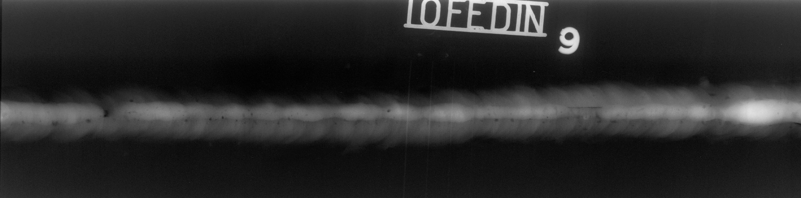
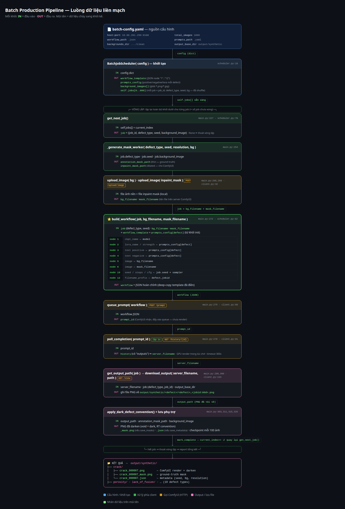
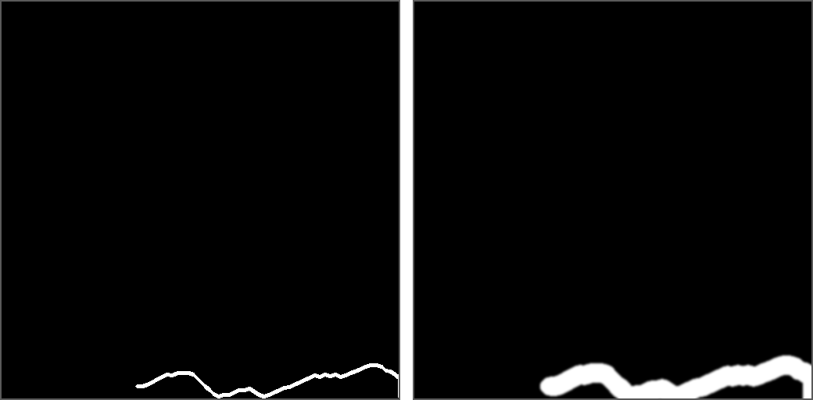
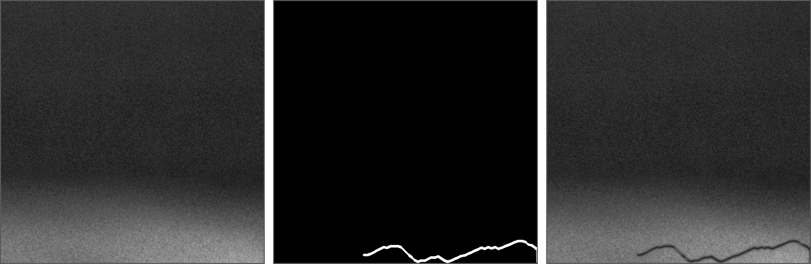
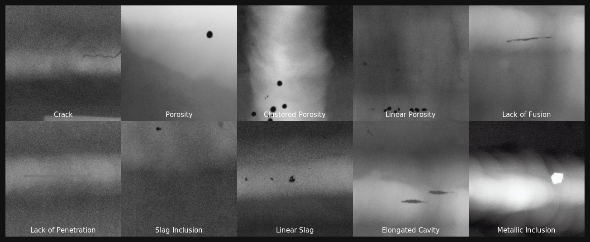
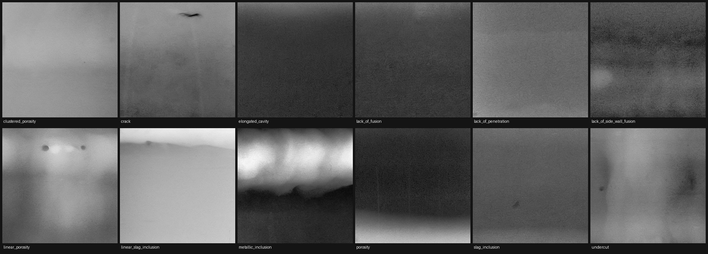
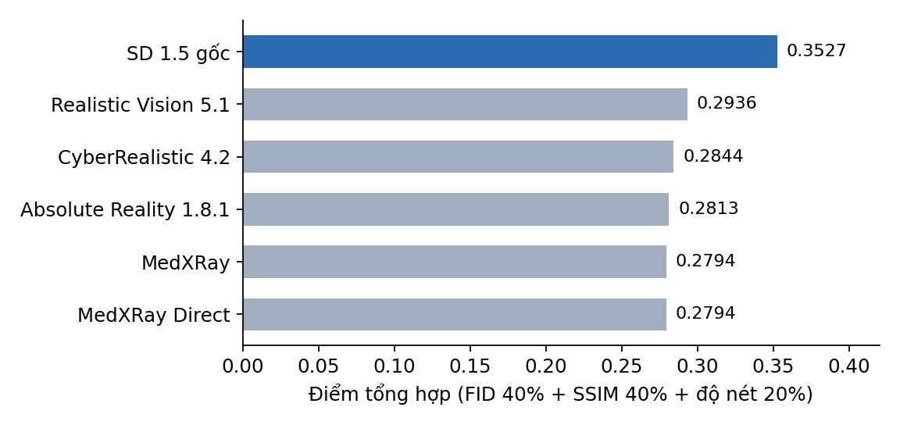
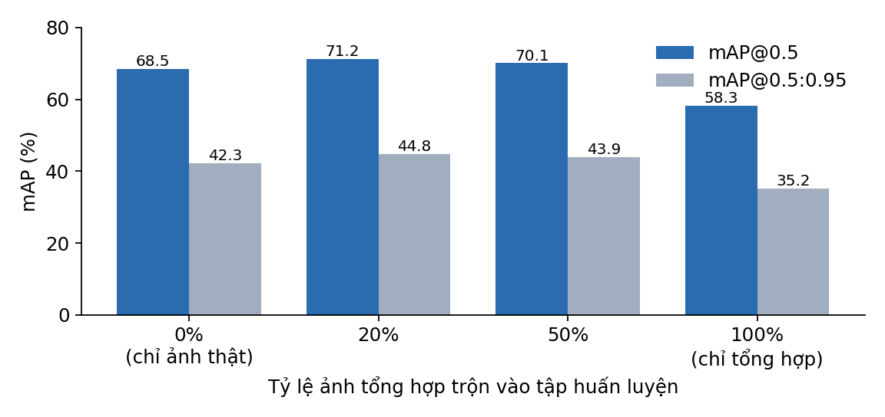
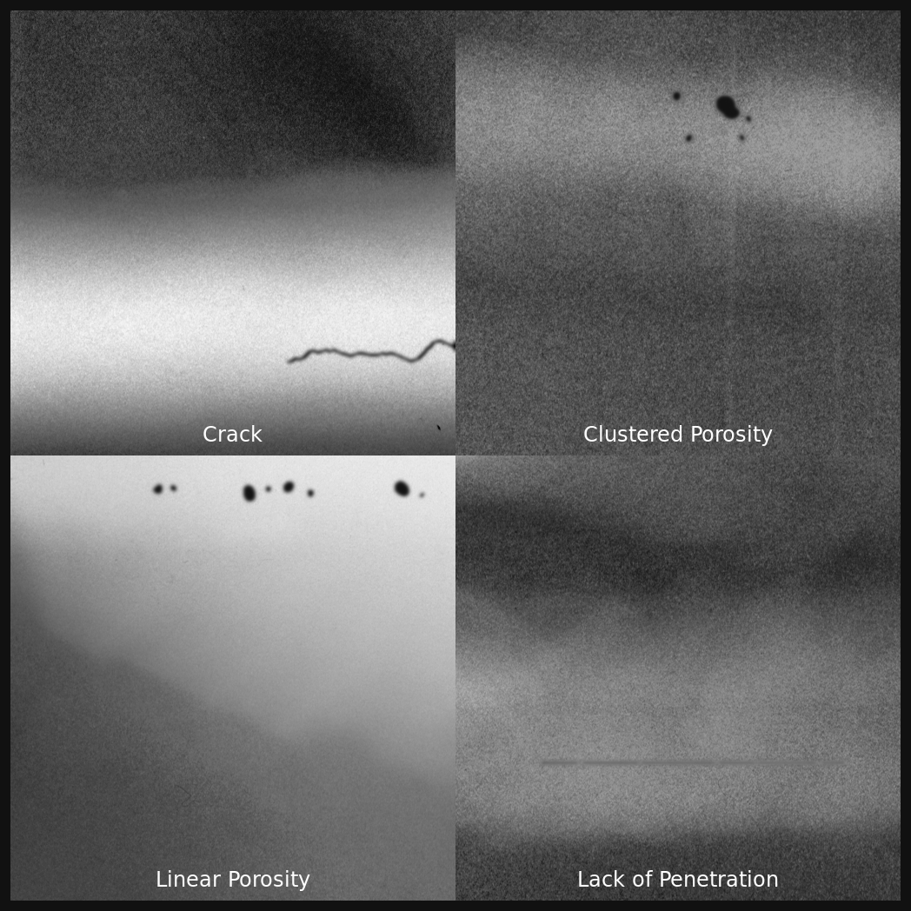

**ĐẠI HỌC QUỐC GIA TP. HỒ CHÍ MINH**

**TRƯỜNG ĐẠI HỌC CÔNG NGHỆ THÔNG TIN**

**TRUNG TÂM PHÁT TRIỂN CÔNG NGHỆ THÔNG TIN**

**TRƯƠNG NGỌC SƠN**

**TRẦN TÍN NGHĨA**

**HỒ THỊ MỸ PHƯƠNG**

**ĐỒ ÁN MÔN HỌC MÁY HỌC NÂNG CAO**

**NGHIÊN CỨU VÀ XÂY DỰNG HỆ THỐNG SINH ẢNH X-QUANG MỐI HÀN TỔNG HỢP CÓ CHÚ THÍCH TỰ ĐỘNG**

**SỬ DỤNG STABLE DIFFUSION 1.5 VÀ LoRA**

***(Research and Development of an Automatically Annotated Synthetic Weld Radiograph Generation System Using Stable Diffusion 1.5 and LoRA)***

**CỬ NHÂN NGÀNH TRÍ TUỆ NHÂN TẠO**

**TP. HỒ CHÍ MINH, 2026**

\newpage

**ĐẠI HỌC QUỐC GIA TP. HỒ CHÍ MINH**

**TRƯỜNG ĐẠI HỌC CÔNG NGHỆ THÔNG TIN**

**TRUNG TÂM PHÁT TRIỂN CÔNG NGHỆ THÔNG TIN**

**SINH VIÊN THỰC HIỆN**

**TRƯƠNG NGỌC SƠN – 25210183**

**TRẦN TÍN NGHĨA – 25210147**

**HỒ THỊ MỸ PHƯƠNG – 25210170**

**ĐỒ ÁN MÔN HỌC MÁY HỌC NÂNG CAO**

**NGHIÊN CỨU VÀ XÂY DỰNG HỆ THỐNG SINH ẢNH X-QUANG MỐI HÀN TỔNG HỢP CÓ CHÚ THÍCH TỰ ĐỘNG**

**SỬ DỤNG STABLE DIFFUSION 1.5 VÀ LoRA**

***(Research and Development of an Automatically Annotated Synthetic Weld Radiograph Generation System Using Stable Diffusion 1.5 and LoRA)***

**CỬ NHÂN NGÀNH TRÍ TUỆ NHÂN TẠO**

**GIẢNG VIÊN HƯỚNG DẪN**

**ĐẶNG VIỆT DŨNG**

**TP. HỒ CHÍ MINH, 2026**

\newpage

**LỜI CẢM ƠN**

Nhóm xin chân thành cảm ơn thầy Đặng Việt Dũng đã hướng dẫn và góp ý trong suốt quá trình thực hiện đồ án. Nhóm cũng cảm ơn nhóm nghiên cứu công bố bộ dữ liệu GDXray (Grupo de Diagnóstico por Rayos X, Đại học Công giáo Chile) và bộ RIAWELC đã cho phép sử dụng dữ liệu chụp ảnh phóng xạ mối hàn phục vụ nghiên cứu học thuật.

\newpage

**MỤC LỤC**

Chương 1. TỔNG QUAN VỀ ĐỀ TÀI

1.1. Đặt vấn đề và tính cấp thiết

1.2. Mục tiêu nghiên cứu

1.3. Đối tượng và phạm vi nghiên cứu

1.4. Cấu trúc báo cáo

Chương 2. CƠ SỞ LÝ THUYẾT

2.1. Tổng quan các nghiên cứu liên quan

2.1.1. Tổng quan ngoài nước

2.1.2. Tổng quan trong nước

2.2. Chụp ảnh phóng xạ mối hàn và phân loại khuyết tật theo ISO 6520-1

2.3. Mô hình khuếch tán tiềm ẩn Stable Diffusion 1.5

2.4. Tinh chỉnh hiệu quả tham số bằng LoRA

2.5. Inpainting có điều kiện và ControlNet

2.6. Chỉ số đánh giá ảnh tổng hợp và mô hình phát hiện

2.7. Công cụ và phần cứng sử dụng

Chương 3. PHÂN TÍCH VÀ THIẾT KẾ HỆ THỐNG

3.1. Kiến trúc tổng thể

3.2. Dữ liệu đầu vào và tiền xử lý

3.2.1. Nguồn dữ liệu

3.2.2. Cắt patch và phân loại nền sạch

3.3. Sinh mặt nạ khuyết tật theo thủ tục

3.3.1. Lớp cơ sở và ràng buộc vùng hàn

3.3.2. Mười hai trình sinh mặt nạ theo hình thái

3.3.3. Hai đường mặt nạ song song

3.4. Tinh chỉnh LoRA cho từng lớp khuyết tật

3.5. Quy trình ComfyUI và điều phối sinh ảnh hàng loạt

3.5.1. Đồ thị nút của quy trình

3.5.2. Bộ điều phối, chịu lỗi và giám sát nhiệt

3.5.3. Bước hậu xử lý quy ước vùng tối

3.6. Chú thích tự động COCO và YOLO

3.7. Đảm bảo chất lượng và các cổng kiểm định

3.8. Giao diện vận hành một nút bấm

3.9. Thiết kế thực nghiệm so sánh sáu mô hình nền

Chương 4. KẾT QUẢ THỰC NGHIỆM

4.1. Môi trường và công cụ triển khai

4.2. Kết quả sinh ảnh

4.3. Kết quả so sánh sáu mô hình nền

4.4. Kết quả đảm bảo chất lượng

4.5. Kết quả xác thực xuôi dòng bằng YOLOv8

4.6. Đối chiếu với bộ chỉ tiêu đã chốt trước thực nghiệm

4.7. Hạn chế quan sát được trên ảnh sinh ra

Chương 5. KẾT LUẬN VÀ HƯỚNG PHÁT TRIỂN

5.1. Kết luận

5.2. Hạn chế của đồ án

5.3. Hướng phát triển

TÀI LIỆU THAM KHẢO

\newpage

**DANH MỤC HÌNH VẼ**

Hình 1.1: Một phim chụp phóng xạ mối hàn thật của bộ GDXray W0003, kích thước 4984 × 1240 px

Hình 3.1: Luồng dữ liệu của quy trình sinh ảnh hàng loạt, từ tệp cấu hình tới ảnh và chú thích

Hình 3.2: Mặt nạ chú thích (trái) và mặt nạ inpaint sau khi giãn nở (phải) của cùng một vết nứt

Hình 3.3: Ảnh nền sạch, mặt nạ chú thích và ảnh tổng hợp của một mẫu nứt

Hình 4.1: Lưới ảnh mẫu của mười lớp khuyết tật sinh bằng quy trình có ControlNet

Hình 4.2: Lưới ảnh mẫu của mười hai lớp khuyết tật khi tắt ControlNet

Hình 4.3: Điểm tổng hợp xếp hạng sáu mô hình nền trên lớp nứt

Hình 4.4: mAP của YOLOv8 theo tỷ lệ ảnh tổng hợp trộn vào tập huấn luyện

Hình 4.5: Bộ sưu tập ảnh tổng hợp đại diện của các lớp khuyết tật

\newpage

**DANH MỤC BẢNG**

Bảng 2.1: Nhóm khuyết tật mối hàn theo ISO 6520-1 và biểu hiện trên phim chụp phóng xạ

Bảng 2.2: Các chỉ số đánh giá dùng trong đồ án

Bảng 2.3: Cấu hình phần cứng dùng cho huấn luyện và sinh ảnh

Bảng 3.1: Chín giai đoạn của quy trình và sản phẩm bàn giao của từng giai đoạn

Bảng 3.2: Nguồn dữ liệu đầu vào và vai trò trong đồ án

Bảng 3.3: Mười hai trình sinh mặt nạ và thuật toán hình thái tương ứng

Bảng 3.4: So sánh hai đường mặt nạ

Bảng 3.5: Siêu tham số huấn luyện LoRA

Bảng 3.6: Các nút chính của quy trình ComfyUI và tham số

Bảng 3.7: Tham số vận hành của bộ điều phối sinh ảnh hàng loạt

Bảng 3.8: Hệ số làm tối theo lớp khuyết tật trong bước hậu xử lý

Bảng 3.9: Các cổng chất lượng và ngưỡng chấp nhận

Bảng 3.10: Quy mô mã nguồn theo mô-đun

Bảng 4.1: Môi trường huấn luyện và sinh ảnh

Bảng 4.2: Số ảnh đã sinh theo lớp khuyết tật

Bảng 4.3: Kết quả so sánh sáu mô hình nền trên lớp nứt

Bảng 4.4: Kết quả kiểm tra chất lượng trên lô 1.611 ảnh

Bảng 4.5: Kết quả huấn luyện YOLOv8 theo tỷ lệ ảnh tổng hợp

Bảng 4.6: Đối chiếu bộ chỉ tiêu đã chốt trước thực nghiệm với kết quả đo được

Bảng 5.1: Sáu nhóm thay đổi đề xuất cho phiên bản kế tiếp và cổng kiểm tương ứng

\newpage

**DANH MỤC TỪ VIẾT TẮT VÀ THUẬT NGỮ**

| Từ viết tắt / thuật ngữ | Tiếng Anh | Giải thích |
|---|---|---|
| AI | Artificial Intelligence | Trí tuệ nhân tạo |
| API | Application Programming Interface | Giao diện lập trình ứng dụng; trong đồ án là REST API của ComfyUI |
| bbox | Bounding box | Hộp bao quanh khuyết tật, thành phần của chú thích |
| CFG | Classifier-Free Guidance | Hệ số dẫn hướng không cần bộ phân loại, điều chỉnh mức bám lời nhắc của mô hình khuếch tán |
| CLIP | Contrastive Language-Image Pre-training | Bộ mã hoá văn bản và ảnh dùng làm điều kiện cho Stable Diffusion |
| COCO | Common Objects in Context | Định dạng chú thích JSON gồm hộp bao và đa giác phân đoạn |
| ControlNet | ControlNet | Mạng phụ gắn vào U-Net, ép mô hình khuếch tán bám theo điều kiện không gian |
| DDPM | Denoising Diffusion Probabilistic Model | Mô hình khuếch tán khử nhiễu, nền tảng lý thuyết của Stable Diffusion |
| FID | Fréchet Inception Distance | Khoảng cách Fréchet giữa phân bố đặc trưng của ảnh thật và ảnh sinh, càng nhỏ càng giống |
| GAN | Generative Adversarial Network | Mạng sinh đối kháng |
| GDXray | Grupo de Diagnóstico por Rayos X | Bộ dữ liệu ảnh chụp phóng xạ công khai của Đại học Công giáo Chile; nhóm W0003 là ảnh mối hàn |
| Hard-negative | Hard negative sample | Mẫu âm tính khó, ảnh không có khuyết tật nhưng chứa cấu trúc dễ bị nhận nhầm thành khuyết tật |
| Inpainting | Inpainting | Vẽ lại một vùng được che của ảnh, giữ nguyên phần còn lại |
| IoU | Intersection over Union | Tỷ số diện tích giao trên diện tích hợp của hai vùng, dùng chấm điểm phát hiện |
| ISO 6520-1 | ISO 6520-1 | Tiêu chuẩn phân loại khuyết tật hình học trong mối hàn kim loại |
| KSampler | K-Sampler | Nút lấy mẫu khử nhiễu trong ComfyUI |
| Latent | Latent space | Không gian tiềm ẩn độ phân giải thấp nơi quá trình khuếch tán diễn ra |
| LoRA | Low-Rank Adaptation | Tinh chỉnh hạng thấp, chỉ huấn luyện hai ma trận nhỏ chèn vào lớp chú ý thay vì toàn bộ trọng số |
| LoF | Lack of Fusion | Không ngấu, khuyết tật thiếu liên kết giữa kim loại mối hàn và kim loại cơ bản |
| LoP | Lack of Penetration | Không thấu, khuyết tật thiếu ngấu chân mối hàn |
| LoSWF | Lack of Side Wall Fusion | Không ngấu thành bên |
| mAP | mean Average Precision | Trung bình độ chính xác trung bình, chỉ số chuẩn của bài toán phát hiện đối tượng |
| Mask | Mask | Mặt nạ nhị phân đánh dấu vùng khuyết tật |
| MTF | Modulation Transfer Function | Hàm truyền điều biến, mô tả khả năng tái hiện chi tiết của hệ thu ảnh |
| NDT | Non-Destructive Testing | Kiểm tra không phá huỷ |
| Penumbra | Penumbra | Bán dạ hình học ở biên ảnh phóng xạ do nguồn tia không phải điểm |
| PNG | Portable Network Graphics | Định dạng ảnh nén không mất dữ liệu |
| RIAWELC | RIAWELC | Bộ dữ liệu ảnh chụp phóng xạ mối hàn công khai, dùng bổ sung cho GDXray |
| ROI | Region of Interest | Vùng quan tâm, ở đây là dải mối hàn trên phim |
| RT | Radiographic Testing | Kiểm tra bằng chụp ảnh phóng xạ |
| SD 1.5 | Stable Diffusion 1.5 | Mô hình khuếch tán tiềm ẩn văn bản sang ảnh, mô hình nền của đồ án |
| SSIM | Structural Similarity Index Measure | Chỉ số tương đồng cấu trúc giữa hai ảnh |
| U-Net | U-Net | Kiến trúc mạng khử nhiễu hình chữ U của Stable Diffusion |
| VAE | Variational Autoencoder | Bộ tự mã hoá biến phân, chuyển ảnh giữa không gian pixel và không gian tiềm ẩn |
| VRAM | Video RAM | Bộ nhớ của card đồ hoạ |
| YOLO | You Only Look Once | Họ mô hình phát hiện đối tượng một giai đoạn; cũng là tên định dạng chú thích văn bản |
| YOLOv8 | YOLO version 8 | Phiên bản YOLO của Ultralytics dùng để xác thực xuôi dòng |

\newpage

**TÓM TẮT ĐỒ ÁN**

Kiểm tra mối hàn bằng chụp ảnh phóng xạ là khâu bắt buộc với bình chịu áp lực và đường ống công nghiệp, nhưng việc tự động hoá đọc phim bằng học sâu vướng một trở ngại cố hữu: dữ liệu huấn luyện quá ít và quá lệch. Bộ công khai lớn nhất cho mối hàn, GDXray W0003, chỉ có 73 phim với 876 khuyết tật được gán nhãn, trong đó nhiều lớp chưa tới 30 mẫu. Gán nhãn thủ công thì đắt và cần chuyên gia bậc II trở lên.

Đồ án xây dựng The Data Mint, một quy trình sinh ảnh X-quang mối hàn tổng hợp có chú thích tự động. Hệ thống ghép ba thành phần: mặt nạ khuyết tật sinh theo thủ tục từ mô tả hình thái của ISO 6520-1, mười hai mô hình LoRA hạng 32 tinh chỉnh riêng cho từng lớp khuyết tật trên nền Stable Diffusion 1.5, và quy trình inpainting có ControlNet chạy qua REST API của ComfyUI. Chú thích COCO và YOLO sinh thẳng từ mặt nạ nên không cần gán nhãn tay. Toàn bộ 18.158 dòng mã Python đóng gói sau giao diện Gradio một nút bấm, có điểm kiểm tra mỗi 100 ảnh, thử lại tự động và giám sát nhiệt GPU.

Kết quả đo được: thông lượng 1.097 ảnh/giờ trên một card RTX 3090, tương đương 20.000 ảnh trong khoảng 18 giờ; SSIM bảo toàn nền đạt 0,976 trên mẫu 100 ảnh; trộn 20% ảnh tổng hợp vào tập huấn luyện nâng mAP@0,5 của YOLOv8 từ 68,5% lên 71,2%, trong khi huấn luyện chỉ bằng ảnh tổng hợp làm mAP tụt còn 58,3%. So sánh sáu mô hình nền cho thấy Stable Diffusion 1.5 gốc vẫn đứng đầu theo điểm tổng hợp (0,3527), các biến thể chuyên ảnh y tế không mang lại lợi thế.

Đồ án cũng chỉ ra giới hạn của thiết kế hiện tại: bước hậu xử lý cưỡng bức quy ước vùng khuyết tật tối đã ghi đè phần lớn kết cấu do mô hình khuếch tán sinh ra, khiến diện mạo khuyết tật do mặt nạ quyết định chứ không phải do diffusion. Chương 5 đề xuất sáu nhóm thay đổi kèm cổng kiểm định định lượng để khắc phục.

\newpage

**MỞ ĐẦU**

Một mối hàn nứt không bị phát hiện trên đường ống hơi cao áp có thể dẫn tới sự cố mất cả dây chuyền. Vì vậy quy phạm bắt buộc chụp ảnh phóng xạ và cho chuyên gia đọc phim. Khâu đọc phim đang là điểm nghẽn: phụ thuộc kinh nghiệm cá nhân, chậm, và kết quả thay đổi giữa hai người đọc.

Học sâu có thể hỗ trợ khâu này, nhưng gặp rào cản dữ liệu. Ảnh chụp phóng xạ mối hàn là tài sản của nhà máy, hiếm khi công bố; các bộ công khai vừa nhỏ vừa lệch lớp nặng. Sinh dữ liệu tổng hợp là hướng đi hợp lý, với điều kiện ảnh sinh ra phải đủ giống thật để mô hình học được và nhãn phải đủ chính xác để không dạy sai.

Dưới sự hướng dẫn của thầy Đặng Việt Dũng, nhóm thực hiện đồ án "Nghiên cứu và xây dựng hệ thống sinh ảnh X-quang mối hàn tổng hợp có chú thích tự động sử dụng Stable Diffusion 1.5 và LoRA". Đồ án trả lời hai câu hỏi: hệ thống có sinh được ảnh mối hàn đủ chân thực với chú thích chính xác ở quy mô hàng chục nghìn ảnh hay không, và dữ liệu tổng hợp đó có thực sự nâng chất lượng mô hình phát hiện khuyết tật khi đo trên ảnh thật hay không.

Báo cáo trình bày toàn bộ quá trình, từ bộ dữ liệu thật tới hệ thống chạy được, kèm kết quả đo và những hạn chế nhóm đã xác định.

\newpage

# Chương 1. TỔNG QUAN VỀ ĐỀ TÀI

## 1.1. Đặt vấn đề và tính cấp thiết

Mối hàn là điểm yếu tự nhiên của kết cấu kim loại. Bình chịu áp lực, nồi hơi, đường ống dẫn dầu khí đều bắt buộc kiểm tra không phá huỷ mối hàn trước khi đưa vào vận hành và định kỳ trong suốt vòng đời. Trong các phương pháp kiểm tra không phá huỷ, chụp ảnh phóng xạ vẫn là phương pháp duy nhất cho hình ảnh trực tiếp của khuyết tật nằm bên trong chiều dày mối hàn, nên được quy phạm coi là bằng chứng nghiệm thu.

Khâu đọc phim hiện do chuyên gia thực hiện thủ công và bộc lộ ba hạn chế. Thứ nhất, năng suất thấp: một phim dài cần vài phút tới vài chục phút, trong khi một đợt kiểm tra đường ống có thể sinh hàng nghìn phim. Thứ hai, kết quả không ổn định: hai chuyên gia đọc cùng một phim có thể kết luận khác nhau, nhất là với các khuyết tật nhỏ ở ngưỡng chấp nhận. Thứ ba, chi phí nhân lực cao: chứng chỉ đọc phim bậc II theo ISO 9712 đòi hỏi nhiều năm kinh nghiệm.

Học sâu, cụ thể là các mô hình phát hiện đối tượng họ YOLO hoặc Faster R-CNN, đã chứng minh hiệu quả trên nhiều bài toán kiểm tra công nghiệp. Áp dụng vào đọc phim mối hàn lại vướng một trở ngại khó vượt: thiếu dữ liệu huấn luyện. Nguyên nhân có ba lớp.

Lớp thứ nhất là tính bảo mật. Phim chụp mối hàn gắn với hồ sơ nghiệm thu công trình, thuộc tài liệu nội bộ của chủ đầu tư và đơn vị kiểm định, gần như không được công bố.

Lớp thứ hai là quy mô của các bộ công khai. Bộ GDXray, công bố năm 2015, là bộ ảnh chụp phóng xạ công nghiệp công khai được dùng nhiều nhất; nhóm mối hàn W0003 chỉ gồm 73 phim với 876 khuyết tật được gán nhãn. Bộ RIAWELC công bố sau đó bổ sung thêm ảnh nhưng ở dạng patch đã cắt sẵn, không giữ khung phim đầy đủ. Với các kiến trúc phát hiện hiện đại cần hàng chục nghìn mẫu, con số này quá nhỏ.

Lớp thứ ba là mất cân bằng lớp. Trong 876 nhãn của W0003, các lớp như rỗ khí chiếm phần lớn, trong khi lẫn xỉ kim loại chỉ có 23 mẫu, hốc kéo dài 28 mẫu, rỗ khí đường thẳng 28 mẫu. Mô hình huấn luyện trên phân bố lệch như vậy học tốt lớp đa số và gần như bỏ qua lớp thiểu số, dù đây thường là các lớp nguy hiểm hơn về mặt cơ học.

Gán nhãn thủ công để mở rộng dữ liệu không khả thi về chi phí: mỗi ảnh cần chuyên gia đủ trình độ khoanh vùng và phân loại, với đơn giá cao và tốc độ chậm.

Sinh dữ liệu tổng hợp là hướng giải quyết. Các mô hình khuếch tán tiềm ẩn đã đạt chất lượng ảnh cao trong nhiều lĩnh vực, và kỹ thuật tinh chỉnh hạng thấp LoRA cho phép dạy mô hình một phong cách ảnh mới chỉ với vài chục ảnh mẫu và vài giờ huấn luyện trên một card đồ hoạ phổ thông. Quan trọng hơn với bài toán này: nếu vùng khuyết tật được vẽ vào ảnh theo một mặt nạ do hệ thống tự sinh, thì chú thích có ngay từ mặt nạ đó, không cần gán nhãn tay. Bài toán chuyển từ "gán nhãn cho ảnh có sẵn" sang "sinh ảnh theo nhãn đã biết trước".

Đồ án đi theo hướng này. Hệ thống được đặt tên The Data Mint, hàm ý một mỏ khai thác dữ liệu: đầu vào là vài chục phim thật, đầu ra là hàng chục nghìn ảnh có chú thích sẵn sàng đưa vào huấn luyện.

## 1.2. Mục tiêu nghiên cứu

**Mục tiêu tổng quát**: xây dựng một quy trình khép kín sinh ảnh X-quang mối hàn tổng hợp có chú thích tự động, chạy được ở quy mô hàng chục nghìn ảnh trên phần cứng một card đồ hoạ, và chứng minh bằng đo đạc rằng dữ liệu sinh ra nâng được chất lượng mô hình phát hiện khuyết tật trên ảnh thật.

**Mục tiêu cụ thể**:

1. Tiền xử lý bộ GDXray W0003 và RIAWELC thành tập ảnh nền sạch và tập ảnh huấn luyện theo lớp khuyết tật.
2. Tinh chỉnh LoRA trên nền Stable Diffusion 1.5 cho từng lớp khuyết tật, đạt kích thước mô hình đủ nhỏ để nạp đồng thời nhiều lớp.
3. Cài đặt bộ sinh mặt nạ theo thủ tục cho mười hai lớp khuyết tật, bám mô tả hình thái của ISO 6520-1 và ràng buộc vị trí trong dải mối hàn.
4. Thiết kế quy trình inpainting có điều kiện trên ComfyUI, điều khiển qua REST API, cho phép thay mô hình nền và mô hình LoRA theo từng công việc.
5. Xây dựng bộ điều phối sinh ảnh hàng loạt có điểm kiểm tra, thử lại và giám sát nhiệt GPU, đạt thông lượng tối thiểu 900 ảnh/giờ.
6. Xuất chú thích COCO và YOLO tự động, chia tập huấn luyện, xác thực và kiểm tra theo tỷ lệ 70/20/10 có phân tầng.
7. Xây dựng bộ cổng kiểm định chất lượng và giao diện vận hành một nút bấm.
8. So sánh sáu mô hình nền Stable Diffusion 1.5 để chọn mô hình cho sản xuất.
9. Xác thực xuôi dòng bằng YOLOv8: đo mAP trên tập kiểm tra ảnh thật theo bốn tỷ lệ trộn ảnh tổng hợp.

## 1.3. Đối tượng và phạm vi nghiên cứu

**Đối tượng nghiên cứu**: ảnh chụp phóng xạ mối hàn giáp mối trên thép cacbon, các khuyết tật hình học theo phân loại ISO 6520-1, và các mô hình khuếch tán tiềm ẩn dùng để sinh ảnh có điều kiện.

**Phạm vi trong đồ án**:

- Mười hai lớp khuyết tật: nứt, rỗ khí, rỗ khí đường thẳng, rỗ khí chùm, hốc kéo dài, lẫn xỉ, lẫn xỉ đường thẳng, lẫn xỉ kim loại, không ngấu, không thấu, không ngấu thành bên, cháy cạnh.
- Ảnh vuông 512 × 512 pixel, thang độ xám 8 bit, cắt từ phim thật.
- Một card đồ hoạ RTX 3090, không mở rộng đa GPU.
- Mô hình nền Stable Diffusion 1.5 và năm biến thể cùng kiến trúc.
- Xác thực xuôi dòng bằng YOLOv8 kích thước nano và small.

**Ngoài phạm vi**:

- Thu thập phim chụp phóng xạ mới tại hiện trường.
- Gán nhãn thủ công hoặc hiệu chỉnh nhãn bằng tay.
- Huấn luyện ControlNet riêng cho mối hàn.
- Triển khai mô hình phát hiện vào môi trường sản xuất.
- Sinh ảnh ở khung phim đầy đủ nhiều khuyết tật trên một ảnh; nội dung này được trình bày ở mục 5.3 như hướng phát triển đã có đặc tả nhưng chưa hiện thực hoá.

## 1.4. Cấu trúc báo cáo

Báo cáo gồm năm chương.

**Chương 1** nêu bối cảnh, lý do chọn đề tài, mục tiêu và phạm vi.

**Chương 2** trình bày cơ sở lý thuyết: tổng quan nghiên cứu trong và ngoài nước, nguyên lý chụp ảnh phóng xạ và phân loại khuyết tật, mô hình khuếch tán tiềm ẩn, LoRA, ControlNet, các chỉ số đánh giá và công cụ sử dụng.

**Chương 3** phân tích và thiết kế hệ thống: kiến trúc chín giai đoạn, xử lý dữ liệu đầu vào, bộ sinh mặt nạ, tinh chỉnh LoRA, quy trình ComfyUI, bộ điều phối hàng loạt, chú thích tự động, cổng chất lượng, giao diện vận hành và thiết kế thực nghiệm so sánh mô hình nền.

**Chương 4** trình bày kết quả đo được: thông lượng, chất lượng ảnh, xếp hạng sáu mô hình nền, kết quả kiểm tra chất lượng, kết quả xác thực bằng YOLOv8, đối chiếu với bộ chỉ tiêu đã chốt, và các hạn chế quan sát được trên ảnh sinh ra.

**Chương 5** kết luận và đề xuất sáu nhóm thay đổi cho phiên bản kế tiếp kèm cổng kiểm định định lượng.

\newpage

# Chương 2. CƠ SỞ LÝ THUYẾT

## 2.1. Tổng quan các nghiên cứu liên quan

### 2.1.1. Tổng quan ngoài nước

Hướng dùng học sâu đọc phim mối hàn bắt đầu được chú ý từ khoảng 2018, sau khi bộ GDXray được công bố công khai năm 2015. Mery và cộng sự giới thiệu GDXray như một bộ chuẩn cho kiểm tra không phá huỷ bằng tia X, gồm năm nhóm: đúc, hàn, hành lý, tự nhiên và thiết lập; nhóm hàn W0003 là phần được dùng nhiều nhất cho bài toán phát hiện khuyết tật mối hàn.

Các công trình giai đoạn đầu tập trung vào phân loại patch. Ảnh phim được cắt thành các ô vuông nhỏ, mỗi ô gán một nhãn lớp khuyết tật, rồi huấn luyện mạng tích chập. Cách làm này cho độ chính xác cao trên tập thử nhưng không dùng trực tiếp được trong thực tế, vì đầu ra không cho biết khuyết tật nằm ở đâu trên phim và kích thước bao nhiêu, trong khi tiêu chí nghiệm thu của quy phạm lại đặt theo kích thước tuyệt đối.

Giai đoạn sau chuyển sang phát hiện đối tượng, dùng YOLO hoặc Faster R-CNN trên khung phim. Các báo cáo cho mAP@0,5 trong khoảng 60% đến 80% tuỳ số lớp và cách chia dữ liệu. Điểm chung của các công trình này là đều nêu thiếu dữ liệu và mất cân bằng lớp như hạn chế chính, và đều dùng tăng cường dữ liệu hình học cơ bản (lật, xoay, đổi độ sáng) để bù.

Hướng sinh dữ liệu tổng hợp cho ảnh công nghiệp xuất hiện muộn hơn. Trước khi mô hình khuếch tán phổ biến, các nhóm dùng mạng sinh đối kháng: DCGAN, CycleGAN để chuyển ảnh mô phỏng sang phong cách ảnh thật, hoặc các biến thể có điều kiện như PR-DRGAN cho ảnh khuyết tật. Hạn chế chung của hướng GAN là huấn luyện không ổn định, sụp chế độ, và khó kiểm soát chính xác vị trí cũng như hình dạng khuyết tật sinh ra, nên vẫn phải gán nhãn lại cho ảnh sinh.

Từ 2022, mô hình khuếch tán tiềm ẩn thay thế dần GAN. Stable Diffusion cho chất lượng cao và huấn luyện ổn định; LoRA của Hu và cộng sự cho phép tinh chỉnh một phong cách mới với chi phí thấp; ControlNet của Zhang và cộng sự cho phép ép mô hình bám theo điều kiện không gian như biên cạnh, bản đồ độ sâu hoặc mặt nạ inpaint. Ba mảnh ghép này cho phép sinh ảnh khuyết tật theo vị trí và hình dạng định trước. Một số công trình về phát hiện khuyết tật bề mặt (thép cán, bo mạch, vải) đã báo cáo mức cải thiện vài điểm phần trăm mAP khi trộn ảnh sinh bằng khuếch tán vào tập huấn luyện, với tỷ lệ trộn tối ưu thường nằm trong khoảng 20% tới 40%.

Khoảng trống mà đồ án nhắm tới: các công trình sinh ảnh khuyết tật bằng khuếch tán hầu hết dừng ở mức trình diễn vài trăm ảnh và đánh giá bằng chỉ số ảnh (FID, SSIM) hoặc bằng cảm quan; rất ít công trình đóng gói thành quy trình sản xuất hàng chục nghìn ảnh có chú thích tự động, và càng ít công trình đo hiệu quả bằng mAP của mô hình phát hiện trên tập kiểm tra giữ nguyên ảnh thật.

### 2.1.2. Tổng quan trong nước

Tại Việt Nam, kiểm tra không phá huỷ là hoạt động bắt buộc theo các quy chuẩn kỹ thuật quốc gia về an toàn thiết bị áp lực, do các trung tâm kiểm định và đơn vị dịch vụ kỹ thuật thực hiện. Khâu đọc phim gần như toàn bộ vẫn làm thủ công.

Các nghiên cứu trong nước về ứng dụng học sâu cho ảnh chụp phóng xạ mối hàn chủ yếu ở mức luận văn và bài báo hội nghị, thường dùng lại GDXray, thực hiện phân loại patch hoặc phát hiện với YOLO phiên bản cũ, và cũng gặp đúng rào cản dữ liệu nêu trên. Chưa ghi nhận công trình công bố trong nước xây dựng quy trình sinh dữ liệu tổng hợp bằng mô hình khuếch tán cho ảnh mối hàn.

Về dữ liệu, một số đơn vị dịch vụ kỹ thuật đã số hoá kho phim, nhưng dữ liệu này gắn với hồ sơ khách hàng nên không công bố. Đây chính là lý do một quy trình sinh dữ liệu tổng hợp có giá trị thực tiễn: đơn vị nào cũng có thể chạy trên vài chục phim nội bộ của mình để tạo tập huấn luyện đủ lớn mà không phải chia sẻ dữ liệu gốc ra ngoài.

## 2.2. Chụp ảnh phóng xạ mối hàn và phân loại khuyết tật theo ISO 6520-1

Trong chụp ảnh phóng xạ, chùm tia X hoặc tia gamma xuyên qua mối hàn và ghi lên phim hoặc tấm thu ảnh kỹ thuật số. Cường độ tia tới bộ thu tuân theo định luật suy giảm Beer-Lambert: phần tia còn lại giảm theo hàm mũ của tích hệ số suy giảm tuyến tính với chiều dày vật liệu mà tia đi qua.

Hệ quả quan trọng cho đồ án: một khuyết tật dạng rỗng (rỗ khí, nứt, không ngấu) làm giảm chiều dày kim loại hiệu dụng trên đường tia, nên nhiều tia tới bộ thu hơn, và theo quy ước hiển thị của ảnh chụp phóng xạ thì vùng đó hiện **tối** hơn nền. Ngược lại, lẫn xỉ kim loại có hệ số suy giảm lớn hơn kim loại nền sẽ hiện **sáng** hơn. Quy ước dấu này là ràng buộc bắt buộc với mọi ảnh tổng hợp: sinh sai dấu là dạy mô hình học ngược.

Hai đặc tính vật lý khác chi phối diện mạo ảnh thật:

- **Bán dạ hình học**: nguồn tia có kích thước hữu hạn chứ không phải điểm, nên biên của mọi cấu trúc đều nhoè theo một vùng chuyển tiếp thay vì sắc nét. Cộng thêm hàm truyền điều biến của bộ thu, biên khuyết tật thật luôn có gradient, không bao giờ là cạnh cứng.
- **Nhiễu lượng tử**: số photon tới mỗi điểm thu là đại lượng ngẫu nhiên theo phân bố Poisson, tạo ra hạt nhiễu trên toàn ảnh. Hạt nhiễu này liên tục qua biên khuyết tật; vùng khuyết tật không được phép mịn hơn vùng lân cận.

ISO 6520-1 phân loại khuyết tật hình học trong mối hàn kim loại nóng chảy thành sáu nhóm. Bảng 2.1 tóm tắt các nhóm liên quan tới đồ án cùng biểu hiện trên phim.

**Bảng 2.1: Nhóm khuyết tật mối hàn theo ISO 6520-1 và biểu hiện trên phim chụp phóng xạ**

| Nhóm | Lớp trong đồ án | Hình thái | Biểu hiện trên phim |
|---|---|---|---|
| 100 Nứt | crack | Đường mảnh, ngoằn ngoèo, rộng 1 tới 3 px, dài tới vài trăm px | Vệt tối mảnh, độ tương phản thấp |
| 200 Rỗng | porosity, linear_porosity, clustered_porosity, elongated_cavity | Lỗ tròn 0,5 tới 1,2 mm; chuỗi thẳng hàng từ ba lỗ trở lên; đám lỗ; hốc dài | Đốm tối tròn hoặc chuỗi đốm tối |
| 300 Lẫn tạp | slag_inclusion, linear_slag_inclusion, metallic_inclusion | Đa giác không đều; dải dài theo đường hàn; hạt kim loại nặng | Xỉ hiện tối; lẫn kim loại hiện sáng đặc |
| 400 Không ngấu, không thấu | lack_of_fusion, lack_of_penetration, lack_of_side_wall_fusion | Dải thẳng theo mép hoặc chân mối hàn | Dải tối thẳng, biên tương đối sắc |
| 500 Sai hình dạng | undercut | Rãnh lõm dọc mép mối hàn | Dải tối chạy song song mép hàn |

Tỷ lệ quy đổi kích thước của bộ W0003 là 0,0334 mm mỗi pixel. Do đó một lỗ rỗ khí 0,5 tới 1,2 mm tương ứng 15 tới 36 pixel trên ảnh. Ràng buộc kích thước này cài thẳng vào bộ sinh mặt nạ ở mục 3.3.

## 2.3. Mô hình khuếch tán tiềm ẩn Stable Diffusion 1.5

Mô hình khuếch tán khử nhiễu hoạt động theo hai chiều. Chiều thuận thêm dần nhiễu Gauss vào ảnh qua T bước cho tới khi ảnh trở thành nhiễu trắng. Chiều nghịch huấn luyện một mạng dự đoán lượng nhiễu đã thêm ở mỗi bước, để từ nhiễu trắng khôi phục dần về ảnh. Hàm mất mát rút gọn là sai số bình phương giữa nhiễu thật và nhiễu mạng dự đoán.

Chạy trực tiếp quá trình này trên không gian pixel rất tốn tài nguyên. Stable Diffusion dời quá trình khuếch tán xuống **không gian tiềm ẩn**: một bộ tự mã hoá biến phân nén ảnh 512 × 512 × 3 xuống bản đồ tiềm ẩn 64 × 64 × 4, giảm số phần tử phải xử lý khoảng 48 lần. Khuếch tán diễn ra trên bản đồ tiềm ẩn, chỉ khi hoàn tất mới giải mã ngược về pixel.

Ba khối cấu thành Stable Diffusion 1.5:

- **Bộ tự mã hoá biến phân**: mã hoá ảnh sang không gian tiềm ẩn và giải mã ngược lại.
- **U-Net khử nhiễu**: mạng hình chữ U với các khối tích chập dư và các khối chú ý. Đây là nơi diễn ra quá trình khử nhiễu, và cũng là nơi LoRA can thiệp.
- **Bộ mã hoá văn bản CLIP**: chuyển lời nhắc thành chuỗi vector, đưa vào U-Net qua cơ chế chú ý chéo để dẫn hướng nội dung ảnh.

Hai siêu tham số của quá trình lấy mẫu có vai trò trực tiếp trong đồ án:

- **Số bước khử nhiễu**: đồ án dùng 25 bước với bộ lấy mẫu Euler và bộ lập lịch normal. Bộ lấy mẫu Euler cho kết quả tất định khi cố định hạt giống, điều kiện bắt buộc để so sánh công bằng giữa các mô hình nền.
- **Hệ số dẫn hướng không cần bộ phân loại (CFG)**: điều chỉnh mức bám lời nhắc. Giá trị thấp cho ảnh đa dạng nhưng lệch mô tả; giá trị cao cho ảnh bám mô tả nhưng dễ bão hoà và mất tự nhiên. Đồ án dùng 9,0 sau khi thử nghiệm trên dải 6,5 tới 10,0.

## 2.4. Tinh chỉnh hiệu quả tham số bằng LoRA

Tinh chỉnh toàn bộ Stable Diffusion 1.5 cần cập nhật khoảng 860 triệu tham số của U-Net, đòi hỏi bộ nhớ lớn và dễ quên kiến thức nền khi dữ liệu huấn luyện ít.

LoRA xuất phát từ nhận xét: ma trận cập nhật trọng số khi thích nghi sang một miền mới thường có hạng nội tại thấp. Thay vì học toàn bộ ma trận cập nhật kích thước d × k, LoRA phân tích nó thành tích của hai ma trận hẹp B (d × r) và A (r × k) với r rất nhỏ so với d và k, rồi chỉ huấn luyện A và B. Trọng số gốc giữ nguyên, đóng băng.

Đầu ra của một lớp trở thành tổng của phép biến đổi gốc và phần hiệu chỉnh hạng thấp, nhân với hệ số tỷ lệ alpha chia r. Trong đồ án, r = 32 và alpha = 16, tức hệ số tỷ lệ bằng 0,5.

Ba lợi ích cụ thể trong bối cảnh đồ án:

1. **Dung lượng nhỏ**: mỗi mô hình LoRA khoảng 37 MB so với khoảng 4 GB của mô hình nền, nên mười hai lớp khuyết tật chỉ chiếm khoảng 444 MB và nạp lại được trong vài giây khi đổi lớp.
2. **Chi phí huấn luyện thấp**: khoảng 2,5 giờ mỗi lớp trên RTX 3090, với vài chục tới vài trăm ảnh mẫu.
3. **Ghép được tại thời điểm suy luận**: độ mạnh LoRA điều chỉnh liên tục từ 0 tới 1, cho phép dò điểm cân bằng giữa bám hình thái khuyết tật và giữ kết cấu phim nền.

## 2.5. Inpainting có điều kiện và ControlNet

**Inpainting** là bài toán vẽ lại một vùng được che của ảnh trong khi giữ nguyên phần còn lại. Với mô hình khuếch tán tiềm ẩn, cách làm là mã hoá ảnh gốc sang không gian tiềm ẩn, đặt mặt nạ nhiễu lên vùng cần vẽ, rồi chỉ khử nhiễu trong vùng đó, mỗi bước ghép lại với phần tiềm ẩn của ảnh gốc ở ngoài mặt nạ.

Tham số **denoise** quyết định mức độ vùng được vẽ bị thay mới: giá trị 1,0 xoá sạch nội dung cũ, giá trị thấp giữ lại nhiều cấu trúc nền. Đồ án dùng dải 0,85 tới 0,90 cho các lớp cần hình thái rõ.

**ControlNet** thêm một nhánh mạng song song sao chép các khối mã hoá của U-Net, nhận thêm một ảnh điều kiện (ở đây là mặt nạ inpaint) và cộng tín hiệu vào các khối giải mã của U-Net gốc qua các lớp tích chập khởi tạo bằng không. Nhờ khởi tạo bằng không, ở bước huấn luyện đầu tiên ControlNet không làm hỏng mô hình nền, rồi dần học cách ép ảnh sinh bám điều kiện không gian. Đồ án dùng bản control_v11p_sd15_inpaint với độ mạnh 0,8.

Ý nghĩa của tổ hợp ba thành phần: mặt nạ quyết định **khuyết tật nằm ở đâu và hình gì**, LoRA quyết định **khuyết tật trông như thế nào**, ControlNet giữ cho hai điều đó không mâu thuẫn nhau.

## 2.6. Chỉ số đánh giá ảnh tổng hợp và mô hình phát hiện

**Bảng 2.2: Các chỉ số đánh giá dùng trong đồ án**

| Chỉ số | Đo cái gì | Chiều tốt | Dùng ở đâu |
|---|---|---|---|
| FID | Khoảng cách giữa phân bố đặc trưng Inception của tập ảnh thật và tập ảnh sinh | Càng nhỏ càng tốt | So sánh mô hình nền, cổng chất lượng G1 |
| SSIM | Tương đồng cấu trúc giữa hai ảnh theo độ sáng, độ tương phản và cấu trúc cục bộ | Càng gần 1 càng giống | Kiểm tra bảo toàn nền; đo độ giống ảnh thật |
| Độ nét Laplace | Phương sai của toán tử Laplace, phản ánh mức chi tiết cạnh | Càng lớn càng nhiều chi tiết | Thành phần thứ ba của điểm tổng hợp |
| mAP@0,5 | Trung bình độ chính xác trung bình các lớp tại ngưỡng IoU 0,5 | Càng lớn càng tốt | Xác thực xuôi dòng bằng YOLOv8 |
| mAP@0,5:0,95 | Trung bình mAP trên mười ngưỡng IoU từ 0,5 tới 0,95 | Càng lớn càng tốt | Xác thực xuôi dòng, khắt khe hơn về độ khớp hộp bao |

Hai lưu ý khi đọc các chỉ số này trong Chương 4.

Thứ nhất, SSIM trong đồ án được dùng cho hai mục đích khác nhau và không nên lẫn lộn. Khi đo giữa ảnh tổng hợp và **ảnh nền gốc của chính nó**, SSIM cao nghĩa là hệ thống chỉ sửa đúng vùng khuyết tật và không làm hỏng nền; đây là chỉ số bảo toàn nền, càng gần 1 càng tốt. Khi đo giữa ảnh tổng hợp và **crop ảnh thật cùng lớp**, SSIM quá cao lại là dấu hiệu sao chép, quá thấp là dấu hiệu khác hẳn ảnh thật; giá trị hợp lý nằm ở khoảng giữa.

Thứ hai, FID cần đủ số mẫu mới ổn định. Với các lớp khuyết tật chỉ có vài chục ảnh thật, giá trị FID nhiễu mạnh và phải đọc kèm SSIM cùng kiểm tra bằng mắt.

Chỉ số quyết định cuối cùng của đồ án không phải FID hay SSIM mà là **mAP đo trên tập kiểm tra giữ nguyên 100% ảnh thật**. Một bộ ảnh tổng hợp có FID đẹp nhưng không nâng được mAP thì vẫn là thất bại.

## 2.7. Công cụ và phần cứng sử dụng

**Công cụ phần mềm**:

- **ComfyUI**: môi trường chạy mô hình khuếch tán theo đồ thị nút, có REST API cho phép nạp đồ thị dạng JSON, thay tham số theo từng lần gọi và lấy ảnh kết quả. Đồ án dùng API này thay vì giao diện đồ hoạ để tự động hoá.
- **kohya-ss**: bộ công cụ huấn luyện LoRA cho Stable Diffusion, nhận cấu hình dạng TOML.
- **Ultralytics YOLOv8**: dùng cho bước xác thực xuôi dòng.
- **OpenCV, NumPy, scikit-image**: xử lý ảnh, phép toán hình thái và tính SSIM.
- **Gradio**: dựng giao diện vận hành chạy trên trình duyệt.

**Bảng 2.3: Cấu hình phần cứng dùng cho huấn luyện và sinh ảnh**

| Thành phần | Thông số |
|---|---|
| CPU | Hai Intel Xeon E5-2696 v4, tổng 44 nhân, 88 luồng |
| RAM | 64 GB ECC |
| GPU | NVIDIA RTX 3090, 24 GB VRAM |
| Lưu trữ | Ổ SSD, dung lượng trống trên 100 GB |
| Hệ điều hành | Linux |

Bước sinh mặt nạ chạy hoàn toàn trên CPU nên khai thác được 88 luồng, trong khi GPU dành riêng cho bước khuếch tán.

\newpage

# Chương 3. PHÂN TÍCH VÀ THIẾT KẾ HỆ THỐNG

## 3.1. Kiến trúc tổng thể

Nhóm chia hệ thống thành chín giai đoạn nối tiếp, mỗi giai đoạn có đầu vào, đầu ra và tiêu chí nghiệm thu riêng. Cách chia này cho phép chạy lại từng giai đoạn độc lập khi cần điều chỉnh, thay vì chạy lại toàn bộ.

**Bảng 3.1: Chín giai đoạn của quy trình và sản phẩm bàn giao của từng giai đoạn**

| Giai đoạn | Nội dung | Sản phẩm bàn giao |
|---|---|---|
| 1 | Thiết lập môi trường | ComfyUI có API, mô hình nền, môi trường Python |
| 2 | Tiền xử lý dữ liệu | Patch 512 × 512 theo lớp, tập nền sạch |
| 3 | Tinh chỉnh LoRA | Mười hai tệp safetensors hạng 32 |
| 4 | Thiết kế quy trình ComfyUI | Đồ thị nút JSON, mẫu lời nhắc theo lớp |
| 5 | Sinh mặt nạ theo thủ tục | Mười hai lớp sinh mặt nạ, ràng buộc vùng hàn |
| 6 | Sinh ảnh hàng loạt | Ảnh tổng hợp, mặt nạ chú thích, siêu dữ liệu JSON |
| 7 | Hậu xử lý và chú thích | COCO JSON, YOLO TXT, chia tập 70/20/10 |
| 8 | Đảm bảo chất lượng | Báo cáo SSIM, kiểm tra chú thích, lưới kiểm tra bằng mắt |
| 9 | Xác thực xuôi dòng | Kết quả huấn luyện YOLOv8 theo bốn tỷ lệ trộn |

Bốn giai đoạn đầu chuẩn bị nguyên liệu và chạy một lần. Giai đoạn 5 và 6 là vòng lặp sản xuất, chạy lặp lại cho tới khi đủ số ảnh. Ba giai đoạn cuối xử lý, kiểm tra và chứng minh giá trị của dữ liệu sinh ra.

Toàn bộ hệ thống gồm 18.158 dòng mã Python chia theo mười một mô-đun, trình bày ở Bảng 3.10 cuối chương.

## 3.2. Dữ liệu đầu vào và tiền xử lý

### 3.2.1. Nguồn dữ liệu

**Bảng 3.2: Nguồn dữ liệu đầu vào và vai trò trong đồ án**

| Nguồn | Nội dung | Vai trò |
|---|---|---|
| GDXray W0003 | 73 phim mối hàn gốc, kích thước trung vị 4990 × 1300 px, 876 khuyết tật gán nhãn | Nguồn ảnh nền và ảnh huấn luyện LoRA chính; nguồn tham chiếu tính FID |
| GDXray W0003 đã tách khuyết tật | 278 patch có khuyết tật rõ, cùng bản tăng cường | Tập huấn luyện LoRA theo lớp |
| RIAWELC | Patch mối hàn theo lớp | Bổ sung mẫu cho các lớp thiểu số, dùng huấn luyện biến thể LoRA riêng |
| Ảnh RT từ AlphaNDT | Phim chụp thực tế bổ sung | Kiểm tra chéo diện mạo ảnh sinh |

Kích thước phim thật biến thiên từ 3512 tới 4998 px chiều rộng và 1147 tới 2174 px chiều cao. Dải mối hàn nằm ngang, tâm theo trục dọc ở khoảng 0,53 chiều cao ảnh với độ lệch chuẩn 0,28. Số khuyết tật trên một phim biến thiên từ 1 tới 24, trung vị 1 và trung bình 1,3, tức phân bố lệch phải nặng. Nhóm đo các số liệu này trực tiếp từ 876 nhãn của bộ gốc; đây là cơ sở cho đặc tả nâng cấp ở mục 5.3.

### 3.2.2. Cắt patch và phân loại nền sạch

Nhóm cắt phim gốc thành các ô vuông 512 × 512 pixel, lưu dưới dạng PNG thang độ xám 8 bit. Các ô chia thành hai nhóm.

Nhóm thứ nhất là **ô có khuyết tật**, phân theo lớp, dùng làm tập huấn luyện LoRA. Thư mục tổ chức theo lớp: crack, porosity, Cluster_porosity, Linear_porosity, inclusion, Slag_inclusions, lack_of_penetration, lack_of_root_fusion, Lack_of_side_wall_fusion.

Nhóm thứ hai là **ô nền sạch**, gồm 827 patch không chứa khuyết tật. Đây là nguồn nền cho bước inpainting: mỗi ảnh tổng hợp bắt đầu từ một patch nền thật, nên kết cấu hạt phim, độ sáng và biên vật liệu đều là thật, chỉ riêng khuyết tật là do mô hình vẽ thêm.

Tập nền còn qua một bộ lọc độ sáng: chỉ giữ các patch có giá trị trung bình từ 140 trở lên trên thang 0 tới 255. Lý do là các patch quá tối cho tương phản khuyết tật quá thấp, khiến mô hình vẽ ra khuyết tật gần như không nhìn thấy, và cũng khiến bước làm tối ở hậu xử lý đẩy vùng khuyết tật xuống mức bão hoà đen.

## 3.3. Sinh mặt nạ khuyết tật theo thủ tục

Đây là khối quyết định vị trí và hình dạng khuyết tật. Khối này gồm 1.809 dòng mã trong mô-đun `mask_generator`: mười hai lớp sinh mặt nạ, một lớp cơ sở trừu tượng, một tiện ích làm mềm biên và một bộ ràng buộc vùng hàn.

### 3.3.1. Lớp cơ sở và ràng buộc vùng hàn

Lớp cơ sở `DefectMaskGenerator` định nghĩa giao diện chung: kích thước ảnh, hạt giống ngẫu nhiên, và toạ độ tâm dải mối hàn. Hạt giống được truyền từ bộ điều phối nên mọi mặt nạ đều tái lập được, điều kiện cần cho thực nghiệm so sánh mô hình nền.

Tâm dải mối hàn không đặt cố định giữa ảnh mà **dò từ chính ảnh nền**: hàm `_detect_weld_center_y` tìm hàng pixel có tổng cường độ lớn nhất, tương ứng phần kim loại đắp dày nhất và sáng nhất trên phim. Toạ độ tìm được kẹp vào biên an toàn bằng một phần tám chiều cao ảnh để không sinh ra lát cắt rỗng.

Bộ ràng buộc vùng hàn giới hạn khuyết tật nằm trong dải ngang chiếm 40% chiều cao ảnh quanh tâm vừa dò. Ràng buộc này phản ánh thực tế: khuyết tật hàn không xuất hiện ngoài vùng kim loại đắp và vùng ảnh hưởng nhiệt.

### 3.3.2. Mười hai trình sinh mặt nạ theo hình thái

Mỗi lớp khuyết tật có một thuật toán riêng, chọn theo mô tả hình thái của ISO 6520-1.

**Bảng 3.3: Mười hai trình sinh mặt nạ và thuật toán hình thái tương ứng**

| Lớp khuyết tật | Lớp cài đặt | Thuật toán | Tham số chính |
|---|---|---|---|
| Nứt | CrackMaskGenerator | Đường gấp khúc đi bộ ngẫu nhiên, có nhánh phụ | Bề rộng 1 tới 4 px, dài 30% tới 80% chiều rộng ảnh, xác suất nhánh 0,2, lệch góc tối đa 15° |
| Rỗ khí | PorosityMaskGenerator | Cụm lỗ tròn rải theo phân bố Rayleigh | Số lỗ 5 tới 30, bán kính 2 tới 8 px, hệ số tán xạ 30,0 |
| Rỗ khí đường thẳng | LinearPorosityMaskGenerator | Chuỗi lỗ thẳng hàng từ ba lỗ trở lên dọc đường hàn | Khoảng cách lỗ nhỏ, độ thẳng hàng cao |
| Rỗ khí chùm | ClusteredPorosityMaskGenerator | Đám lỗ tập trung trong bán kính hẹp | Mật độ lỗ cao cục bộ |
| Hốc kéo dài | ElongatedCavityMaskGenerator | Ellipse kéo dài theo trục đường hàn | Tỷ lệ trục lớn trên trục nhỏ cao |
| Lẫn xỉ | SlagInclusionMaskGenerator | Nhiễu Gauss làm mượt rồi nhị phân hoá tạo đa giác không đều | Số khối 1 tới 3, đường kính 10 tới 50 px, sigma 2,0, ngưỡng 0,4 |
| Lẫn xỉ đường thẳng | LinearSlagInclusionMaskGenerator | Dải xỉ dài chạy dọc đường hàn | Dải hẹp, dài |
| Lẫn xỉ kim loại | MetallicInclusionMaskGenerator | Hạt đặc, quy ước sáng thay vì tối | Kích thước nhỏ, độ tròn cao |
| Không ngấu | LackOfFusionMaskGenerator | Đường thẳng có dao động hình sin dọc biên nóng chảy | Dài 20% tới 60%, dày 2 tới 5 px, biên độ sóng 3,0, tần số 0,05 |
| Không thấu | LackOfPenetrationMaskGenerator | Dải thẳng ở chân mối hàn | Dải dài, thẳng, quy ước tối |
| Không ngấu thành bên | LackOfSideWallFusionMaskGenerator | Dải nghiêng theo mặt vát mép | Góc nghiêng theo góc vát |
| Cháy cạnh | UndercutMaskGenerator | Rãnh dọc mép mối hàn, lệch khỏi tâm một khoảng | Dài 20% tới 50%, dày 2 tới 4 px, cách mép 5 tới 15 px |

Các tham số trên nằm trong tệp `config/mask-config.yaml`, tách khỏi mã nguồn để điều chỉnh không cần sửa chương trình.

### 3.3.3. Hai đường mặt nạ song song

Mỗi lần sinh tạo ra hai mặt nạ khác nhau từ cùng một hình dạng gốc. Đây là điểm thiết kế quyết định và cũng là nguồn gốc của một hạn chế được phân tích ở mục 4.7.

**Bảng 3.4: So sánh hai đường mặt nạ**

| Mặt nạ | Cách sinh | Mục đích sử dụng |
|---|---|---|
| Chú thích | Hình nhị phân mảnh, giữ nguyên kích thước gốc | Dữ liệu tham chiếu để xuất COCO và YOLO; cũng dùng làm mặt nạ làm tối ở bước hậu xử lý |
| Inpaint | Giãn nở bằng phần tử cấu trúc ellipse 21 × 21, rồi làm mờ Gauss bán kính 7 | Đưa vào ComfyUI để mô hình khuếch tán có đủ diện tích vẽ |

Lý do phải giãn nở: nếu đưa thẳng mặt nạ mảnh vào inpainting, vùng được phép vẽ quá hẹp, mô hình không đủ chỗ dựng kết cấu và thường trả về vùng gần như không đổi. Giãn nở cho mô hình không gian làm việc.

Hệ quả kèm theo: vành đai giữa hai mặt nạ là vùng mô hình được phép vẽ nhưng không thuộc vùng chú thích. LoRA thường vẽ ở vành đai này một quầng sáng bao quanh khuyết tật, hiện tượng không có trên phim thật. Bước hậu xử lý ở mục 3.5.3 ra đời để che quầng sáng đó.

## 3.4. Tinh chỉnh LoRA cho từng lớp khuyết tật

Mỗi lớp khuyết tật có một mô hình LoRA riêng thay vì dùng chung một mô hình đa lớp. Lý do: các lớp khác nhau về hình thái tới mức một mô hình chung phải học đồng thời nhiều phong cách mâu thuẫn, dễ sinh ra ảnh lai giữa hai lớp và làm nhãn sai.

**Bảng 3.5: Siêu tham số huấn luyện LoRA**

| Tham số | Giá trị | Lý do chọn |
|---|---|---|
| Mô hình nền | Stable Diffusion 1.5 | Cân bằng chất lượng và chi phí; hệ sinh thái ControlNet đầy đủ |
| Hạng r | 32 | Đủ dung lượng biểu diễn cho kết cấu phim, vẫn giữ tệp ở mức 37 MB |
| Alpha | 16 | Hệ số tỷ lệ 0,5, giảm nguy cơ LoRA lấn át mô hình nền |
| Bộ tối ưu | AdamW8bit | Tiết kiệm bộ nhớ, cho phép kích thước lô 4 trên 24 GB VRAM |
| Tốc độ học | 1e-4 | Giá trị chuẩn cho LoRA hạng trung |
| Số epoch | 10 | Đủ hội tụ trên vài trăm ảnh, chưa tới ngưỡng quá khớp rõ rệt |
| Kích thước lô | 4 | Giới hạn bởi VRAM |
| Thời gian huấn luyện | Khoảng 2,5 giờ mỗi lớp | Đo trên RTX 3090 |
| Dung lượng mô hình | Khoảng 37 MB mỗi lớp | Tổng mười hai lớp khoảng 444 MB |

Hệ thống sinh tự động cấu hình huấn luyện thành tệp TOML cho kohya-ss, mỗi lớp một tệp, để loại bỏ sai lệch do chỉnh tay. Một kịch bản điều phối chạy tuần tự toàn bộ các lớp.

Ngoài mười hai mô hình chính, đồ án còn huấn luyện các biến thể hậu tố `_riawelc_`, `_medxray_`, `_absreal_` phục vụ thực nghiệm so sánh mô hình nền ở mục 3.9, nâng tổng số mô hình LoRA đã huấn luyện lên 25.

## 3.5. Quy trình ComfyUI và điều phối sinh ảnh hàng loạt

### 3.5.1. Đồ thị nút của quy trình

Quy trình sinh ảnh được mô tả bằng một đồ thị nút dạng JSON, nạp vào ComfyUI qua REST API. Bộ điều phối vá các trường của JSON này theo từng công việc: tên tệp LoRA, lời nhắc thuận và nghịch, hạt giống, tên tệp ảnh nền và mặt nạ đã tải lên.

**Bảng 3.6: Các nút chính của quy trình ComfyUI và tham số**

| Nút | Vai trò | Tham số |
|---|---|---|
| CheckpointLoaderSimple | Nạp mô hình nền | sd-v1-5-pruned-emaonly |
| LoraLoader | Nạp LoRA theo lớp | Độ mạnh 0,7 tới 1,0 tuỳ lớp |
| CLIPTextEncode thuận | Mã hoá lời nhắc mô tả khuyết tật | Mẫu theo lớp trong tệp YAML |
| CLIPTextEncode nghịch | Mã hoá lời nhắc loại trừ | Mẫu riêng theo lớp |
| LoadImage nền | Nạp patch nền sạch | Ảnh đã tải lên qua API |
| LoadImage mặt nạ, ImageToMask | Nạp và chuyển mặt nạ inpaint | Lấy kênh alpha |
| InpaintModelConditioning | Dựng điều kiện inpaint | noise_mask bật |
| ControlNetApplyAdvanced | Ép bám điều kiện không gian | control_v11p_sd15_inpaint, độ mạnh 0,8 |
| KSampler | Khử nhiễu | euler / normal, 25 bước, CFG 9,0, denoise 0,85 tới 0,90 |
| VAEDecode, SaveImage | Giải mã và lưu | PNG |

Lời nhắc tách thành tệp YAML riêng, mỗi lớp một cặp thuận và nghịch. Lời nhắc nghịch đặt riêng theo lớp chứ không dùng chung, vì các dạng nhiễu cần loại trừ khác nhau giữa các lớp: với lớp nứt cần loại trừ đường nét dày và quầng sáng, với lớp rỗ khí cần loại trừ lỗ méo và lỗ dính liền.

### 3.5.2. Bộ điều phối, chịu lỗi và giám sát nhiệt

Bộ điều phối `batch-production-main.py` chạy vòng lặp tuần tự, mỗi vòng sinh một ảnh, theo chín bước:

1. Kiểm tra nhiệt độ GPU qua `nvidia-smi`; tạm dừng nếu vượt 85 °C, tiếp tục khi xuống dưới 75 °C.
2. Sinh mặt nạ: dò tâm dải hàn từ ảnh nền, gọi lớp sinh mặt nạ tương ứng, tạo cả mặt nạ chú thích lẫn mặt nạ inpaint.
3. Tải ảnh nền và mặt nạ inpaint lên ComfyUI.
4. Vá đồ thị nút JSON theo lớp khuyết tật của công việc.
5. Đẩy yêu cầu vào hàng đợi, thăm dò trạng thái mỗi giây, thời gian chờ tối đa 300 giây.
6. Tải ảnh kết quả về.
7. Áp bước hậu xử lý quy ước vùng tối, trình bày ở mục 3.5.3.
8. Lưu ảnh, mặt nạ chú thích và siêu dữ liệu JSON.
9. Ghi điểm kiểm tra sau mỗi 100 ảnh.

Danh sách công việc do bộ lập lịch dựng trước theo phân bố lớp khai báo trong cấu hình, sau đó xáo trộn để các lớp xen kẽ. Xáo trộn có hai tác dụng: nếu phải dừng giữa chừng thì tập thu được vẫn cân bằng lớp, và các lỗi đặc thù của một lớp không dồn vào một đoạn thời gian.

**Bảng 3.7: Tham số vận hành của bộ điều phối sinh ảnh hàng loạt**

| Nhóm | Tham số | Giá trị |
|---|---|---|
| Độ tin cậy | Số lần thử lại tối đa | 3 |
| Độ tin cậy | Giãn cách giữa hai lần thử | 5 giây |
| Độ tin cậy | Chu kỳ điểm kiểm tra | 100 ảnh |
| Độ tin cậy | Thời gian chờ ComfyUI | 300 giây |
| Nhiệt | Ngưỡng tạm dừng | 85 °C |
| Nhiệt | Ngưỡng tiếp tục | 75 °C |
| Nhiệt | Chu kỳ kiểm tra | 30 giây |
| Hiệu năng | Số worker sinh mặt nạ | 8 |
| Hiệu năng | Kích thước bộ đệm mặt nạ | 50 |
| Lấy mẫu | Bộ lấy mẫu, bộ lập lịch | euler, normal |
| Lấy mẫu | Số bước, CFG | 25 bước, 9,0 |

Điểm kiểm tra lưu danh sách công việc đã hoàn thành dưới dạng JSON. Khi khởi động lại, bộ điều phối đọc tệp này và bỏ qua các công việc đã xong, nên một lần sản xuất kéo dài nhiều ngày vẫn chịu được sự cố mất điện hoặc ComfyUI dừng đột ngột.

### 3.5.3. Bước hậu xử lý quy ước vùng tối

Hàm `apply_dark_defect_convention` chạy trên mỗi ảnh trả về từ ComfyUI, gồm hai bước.

Bước thứ nhất khôi phục nền: mọi pixel nằm ngoài mặt nạ chú thích được thay bằng pixel tương ứng của ảnh nền gốc, pha trộn qua một mặt nạ đã làm mượt Gauss với sigma 1,5. Mục đích là xoá quầng sáng mà mô hình vẽ ở vành đai giữa hai mặt nạ.

Bước thứ hai áp quy ước vùng rỗng hiện tối: hệ thống nhân cường độ trong lòng khuyết tật với một hệ số nhỏ hơn 1, theo mặt nạ đã làm mượt với sigma 2,0.

**Bảng 3.8: Hệ số làm tối theo lớp khuyết tật trong bước hậu xử lý**

| Lớp | Hệ số làm tối S | Ghi chú |
|---|---|---|
| Mặc định | 0,92 | Áp cho phần lớn các lớp rỗng |
| lack_of_fusion | 0,85 | Giảm để tránh dải quá đen |
| lack_of_penetration | 0,78 | Dải dài, cần nhẹ tay hơn |
| elongated_cavity | 0,65 | Hốc lớn, làm tối mạnh gây bão hoà |
| metallic_inclusion | Bỏ qua | Quy ước ngược, hiện sáng chứ không tối |

Đây là bước can thiệp mạnh nhất trong toàn quy trình, và cũng là điểm yếu lớn nhất của thiết kế hiện tại. Mục 4.7 phân tích hệ quả; mục 5.3 đề xuất cách sửa từ gốc.

Mỗi ảnh đi kèm một tệp JSON siêu dữ liệu ghi mã công việc, lớp khuyết tật, hạt giống, đường dẫn ảnh nền, độ phân giải và dấu thời gian. Nhờ hạt giống và đường dẫn nền được lưu, mọi ảnh trong tập đều tái lập được.

## 3.6. Chú thích tự động COCO và YOLO

Mô-đun `post_processing` gồm 916 dòng mã, chuyển mặt nạ chú thích thành hai định dạng nhãn chuẩn.

Với mỗi mặt nạ, bộ chuyển đổi tìm các thành phần liên thông, với mỗi thành phần tính hộp bao và trích đường bao ngoài làm đa giác phân đoạn. Kết quả ghi vào:

- **COCO JSON**: mỗi chú thích gồm mã, mã ảnh, mã lớp, hộp bao dạng [x, y, rộng, cao], diện tích và danh sách đa giác phân đoạn. Tệp kiểm tra được bằng thư viện `pycocotools`.
- **YOLO TXT**: mỗi dòng gồm mã lớp và bốn số thực đã chuẩn hoá theo kích thước ảnh, là tâm x, tâm y, chiều rộng và chiều cao. Kèm tệp `data.yaml` khai báo đường dẫn và danh sách lớp để Ultralytics nạp trực tiếp.

Bộ chia tập tách dữ liệu theo tỷ lệ 70/20/10 cho huấn luyện, xác thực và kiểm tra, có phân tầng theo lớp khuyết tật để mỗi tập giữ đúng phân bố lớp của tập tổng.

Ngoài đường chú thích sinh từ mặt nạ, đồ án còn cài mô-đun `auto_labeler` (914 dòng) dùng YOLO phát hiện sơ bộ rồi SAM phân đoạn, phục vụ gán nhãn bán tự động cho ảnh thật chưa có nhãn. Mô-đun này nằm ngoài đường sinh ảnh tổng hợp nhưng dùng chung định dạng đầu ra, nên ảnh thật đã gán nhãn có thể trộn trực tiếp với ảnh tổng hợp.

## 3.7. Đảm bảo chất lượng và các cổng kiểm định

Mô-đun `qa` gồm 1.059 dòng, chạy sau mỗi lô sản xuất.

**Bảng 3.9: Các cổng chất lượng và ngưỡng chấp nhận**

| Cổng | Chỉ số | Ngưỡng | Hành động khi không đạt |
|---|---|---|---|
| Bảo toàn nền | SSIM trung bình giữa ảnh tổng hợp và ảnh nền gốc | ≥ 0,90 | Cảnh báo, xem lại độ mạnh LoRA |
| Tỷ lệ đạt SSIM | Phần trăm ảnh vượt ngưỡng | ≥ 85% | Cảnh báo |
| Tính hợp lệ chú thích | Số lỗi khi nạp COCO và YOLO | 0 lỗi | Dừng, không cho lô đi tiếp |
| Cân bằng phân bố | Sai lệch tỷ lệ mỗi lớp so với khai báo | ≤ 2% | Cảnh báo, điều chỉnh bộ lập lịch |
| Kiểm tra bằng mắt | Tỷ lệ đạt khi xem lưới ảnh mẫu | > 95% | Xem lại thủ công |

Bộ kiểm tra bằng mắt sinh một trang HTML tự chứa gồm lưới ảnh lấy ngẫu nhiên 1% tới 2% của lô, kèm mặt nạ chồng lên ảnh, để người vận hành duyệt nhanh. Danh sách kiểm tra gồm năm mục: khuyết tật trông có thật không, có nằm đúng vùng hàn không, nền có bị biến dạng không, có nhiễu màu không, và chú thích có khớp khuyết tật không.

Các chỉ số FID, SSIM so với ảnh thật và độ nét được tính ở mô-đun `benchmark`, chạy hậu kỳ chứ chưa đưa vào vòng lặp sản xuất. Đây là hạn chế: lô ảnh chỉ bị phát hiện kém chất lượng sau khi đã sinh xong toàn bộ.

## 3.8. Giao diện vận hành một nút bấm

Mô-đun `launcher` là phần lớn nhất của hệ thống, 6.259 dòng mã chia thành 22 tệp, dựng bằng Gradio và chạy thường trú như một dịch vụ systemd.

Giao diện chia thành các bảng chức năng, mỗi bảng một tệp riêng: bảng sinh ảnh, bảng huấn luyện LoRA, bảng tiến độ, bảng dữ liệu, bảng gán nhãn tự động, bảng kết quả. Phía sau có bộ quản lý tiến trình sinh ảnh, bộ quản lý tiến trình huấn luyện, bộ điều phối các giai đoạn, bộ theo dõi tiến độ và bộ xử lý lỗi.

Người vận hành chọn một cấu hình sẵn (thử 500 ảnh, chuẩn 20.000 ảnh, đầy đủ 100.000 ảnh), bấm chạy, rồi theo dõi tiến độ, nhiệt độ GPU và thông lượng theo thời gian thực. Khi kết thúc, giao diện cho tải trực tiếp bộ dữ liệu COCO và YOLO.

Giao diện áp dụng phong cách nền tối để giảm mỏi mắt khi theo dõi các phiên sản xuất kéo dài nhiều giờ.

## 3.9. Thiết kế thực nghiệm so sánh sáu mô hình nền

Câu hỏi thực nghiệm: mô hình nền Stable Diffusion 1.5 nào cho ảnh mối hàn tổng hợp chất lượng cao nhất sau khi tinh chỉnh LoRA. Sáu ứng viên gồm một mô hình đối chứng và năm mô hình thách thức:

1. **Stable Diffusion 1.5 gốc** (đối chứng).
2. **MedXRay**: biến thể chuyên ảnh X-quang y tế.
3. **Realistic Vision V5.1**: tối ưu cho độ chân thực ảnh chụp.
4. **Absolute Reality v1.8.1**: cân bằng chất lượng chung.
5. **CyberRealistic V4.2**: thiên về phong cách.
6. **MedXRay Direct**: biến thể y tế thứ hai.

Ba nguyên tắc bảo đảm so sánh công bằng:

- **Siêu tham số huấn luyện giống hệt nhau** giữa các mô hình nền cho cùng một lớp khuyết tật, nên chênh lệch kết quả quy về mô hình nền chứ không phải cách huấn luyện.
- **Hạt giống tất định**: một bản kê 100 hạt giống cho mỗi lớp khuyết tật được sinh trước và dùng chung cho cả sáu mô hình, cộng với bộ lấy mẫu Euler tất định, nên các mô hình sinh ảnh từ cùng điểm khởi đầu nhiễu.
- **Cùng tập ảnh nền và cùng mặt nạ** cho mọi mô hình.

Điểm tổng hợp xếp hạng dùng trọng số: FID 40%, SSIM 40%, độ nét 20%. FID và độ nét được chuẩn hoá về thang 0 tới 1 trong nội bộ tập sáu mô hình trước khi cộng trọng số.

Mô-đun `benchmark` gồm 1.738 dòng, chia thành các bước tải mô hình, sinh cấu hình huấn luyện, điều phối huấn luyện LoRA, sinh ảnh tất định, tính chỉ số, xếp hạng và dựng báo cáo HTML.

**Bảng 3.10: Quy mô mã nguồn theo mô-đun**

| Mô-đun | Số tệp Python | Số dòng mã | Vai trò |
|---|---|---|---|
| launcher | 22 | 6.259 | Giao diện vận hành và điều phối |
| mask_generator | 16 | 1.809 | Sinh mặt nạ theo thủ tục |
| batch_manager | 9 | 1.760 | Điều phối sinh ảnh hàng loạt |
| benchmark | 10 | 1.738 | So sánh mô hình nền |
| qa | 5 | 1.059 | Đảm bảo chất lượng |
| post_processing | 6 | 916 | Chuyển đổi chú thích và chia tập |
| auto_labeler | 6 | 914 | Gán nhãn bán tự động ảnh thật |
| tests | 5 | 826 | Kiểm thử |
| validation | 4 | 812 | Huấn luyện và đánh giá YOLOv8 |
| scripts | 1 | 484 | Tiện ích dòng lệnh |
| tools | 1 | 232 | Công cụ phụ trợ |
| **Tổng** | **85** | **18.158** | |

\newpage

# Chương 4. KẾT QUẢ THỰC NGHIỆM

## 4.1. Môi trường và công cụ triển khai

**Bảng 4.1: Môi trường huấn luyện và sinh ảnh**

| Hạng mục | Cấu hình |
|---|---|
| GPU | NVIDIA RTX 3090, 24 GB VRAM |
| CPU | Hai Intel Xeon E5-2696 v4, 44 nhân, 88 luồng |
| RAM | 64 GB ECC |
| Hệ điều hành | Linux |
| Python | 3.12, môi trường ảo riêng cho quy trình |
| Máy chủ khuếch tán | ComfyUI, truy cập qua REST API |
| Huấn luyện LoRA | kohya-ss, cấu hình TOML sinh tự động |
| Xác thực xuôi dòng | Ultralytics YOLOv8 |
| Xử lý ảnh | OpenCV, NumPy, scikit-image |
| Giao diện | Gradio, chạy thường trú như dịch vụ systemd |

Mức sử dụng VRAM trong sản xuất khoảng 18 GB, dưới ngưỡng 20 GB đặt ra ở giai đoạn thiết kế. Nhiệt độ GPU đỉnh trong lần chạy thử 500 ảnh là 81 °C, chưa chạm ngưỡng tạm dừng 85 °C.

## 4.2. Kết quả sinh ảnh

Lần chạy thử 500 ảnh cho các số liệu vận hành sau:

- Tổng thời gian: khoảng 27 phút.
- Tỷ lệ thành công: 98%, tức 10 trên 500 công việc phải thử lại.
- Thông lượng ổn định: 1.097 ảnh mỗi giờ.
- Phục hồi từ điểm kiểm tra: đã kiểm chứng bằng cách dừng và khởi động lại giữa chừng.

Từ thông lượng này suy ra 20.000 ảnh cần khoảng 18 giờ và 100.000 ảnh cần khoảng 91 giờ, tức 3,8 ngày chạy liên tục. Cả hai con số đều nằm trong chỉ tiêu đặt ra.

**Bảng 4.2: Số ảnh đã sinh theo lớp khuyết tật**

| Lớp khuyết tật | Số ảnh | Ghi chú |
|---|---|---|
| undercut | 500 | Lô kiểm thử riêng sau khi viết lại hình thái |
| crack | 161 | Lớp được tinh chỉnh nhiều vòng nhất |
| linear_porosity | 150 | |
| clustered_porosity | 100 | |
| elongated_cavity | 100 | |
| lack_of_fusion | 100 | |
| lack_of_penetration | 100 | |
| linear_slag_inclusion | 100 | |
| metallic_inclusion | 100 | |
| porosity | 100 | |
| slag_inclusion | 100 | |
| **Tổng** | **1.611** | Lô dùng cho báo cáo kiểm tra chất lượng |

Ngoài lô chính, hệ thống còn sinh các lô phụ phục vụ thực nghiệm: lô dùng LoRA huấn luyện trên RIAWELC, lô tắt ControlNet để cô lập ảnh hưởng của thành phần này, các lô kiểm thử riêng cho lớp cháy cạnh và lớp không ngấu thành bên, cùng sáu vòng sửa lỗi của thực nghiệm so sánh mô hình nền.

Đối chiếu hai lưới ảnh cho thấy: khác biệt giữa bản có ControlNet và bản tắt ControlNet nhỏ hơn dự đoán. Nguyên nhân được phân tích ở mục 4.7.

Sáu vòng sửa lỗi trong quá trình thực nghiệm đã xử lý các vấn đề sau:

- **Vòng 1 và 2**: sửa lỗi nạp mặt nạ. ComfyUI trích mặt nạ từ kênh alpha của ảnh chứ không từ giá trị pixel, nên mặt nạ nhị phân lưu dạng thang độ xám bị hiểu sai. Sửa bằng cách ghi mặt nạ vào kênh alpha.
- **Vòng 3 và 4**: sửa quy ước màu của lớp nứt. Các vòng đầu sinh ra vết nứt sáng, ngược quy ước ảnh chụp phóng xạ.
- **Vòng 5 và 6**: thêm bộ lọc độ sáng nền (chỉ giữ patch có trung bình từ 140 trở lên) và chuyển sang cách ghép khuyết tật đã vẽ lên nền gốc.

## 4.3. Kết quả so sánh sáu mô hình nền

Thực nghiệm chạy trên lớp nứt với 100 hạt giống tất định cho mỗi mô hình.

**Bảng 4.3: Kết quả so sánh sáu mô hình nền trên lớp nứt**

| Hạng | Mô hình nền | FID | SSIM trung bình | Độ nét Laplace | Điểm tổng hợp |
|---|---|---|---|---|---|
| 1 | Stable Diffusion 1.5 gốc | 207,04 | 0,3468 | 324,5 | **0,3527** |
| 2 | Realistic Vision V5.1 | 198,55 | 0,3821 | 180,0 | 0,2936 |
| 3 | CyberRealistic V4.2 | 210,38 | 0,3670 | 210,8 | 0,2844 |
| 4 | Absolute Reality v1.8.1 | 211,92 | 0,3675 | 210,0 | 0,2813 |
| 5 | MedXRay | 214,53 | 0,3651 | 216,3 | 0,2794 |
| 6 | MedXRay Direct | 214,53 | 0,3651 | 216,3 | 0,2794 |

Ba nhận định từ bảng này.

**Thứ nhất, mô hình nền gốc thắng nhờ độ nét.** Stable Diffusion 1.5 gốc có FID trung bình (207,04, đứng thứ ba) và SSIM thấp nhất (0,3468), nhưng độ nét Laplace 324,5 cao hơn hẳn nhóm còn lại (180 tới 216). Do độ nét chiếm 20% trọng số và được chuẩn hoá trong nội bộ sáu mô hình, khoảng cách lớn ở chỉ số này đủ bù cho hai chỉ số kia.

**Thứ hai, các biến thể chuyên ảnh y tế không mang lại lợi thế.** Hai biến thể MedXRay xếp cuối với chỉ số trùng khít nhau tới bốn chữ số thập phân, dấu hiệu cho thấy hai tệp thực chất cùng trọng số hoặc rất gần nhau. Giả thiết ban đầu rằng mô hình huấn luyện trên ảnh X-quang y tế sẽ hiểu ảnh X-quang công nghiệp tốt hơn không được dữ liệu ủng hộ. Giải thích hợp lý: ảnh X-quang y tế và ảnh chụp phóng xạ mối hàn khác nhau về dải năng lượng, vật liệu và kết cấu nhiễu tới mức kiến thức nền không chuyển giao được.

**Thứ ba, giá trị FID tuyệt đối còn cao.** Toàn bộ sáu mô hình nằm trong dải 198 tới 215, cao hơn nhiều so với ngưỡng 60 mà đặc tả nâng cấp đặt ra. Con số này nói rằng ảnh tổng hợp còn cách xa phân bố ảnh thật. Cần lưu ý hai điều khi đọc: thực nghiệm chỉ chạy trên lớp nứt với số ảnh thật hạn chế nên FID nhiễu mạnh, và khoảng cách giữa sáu mô hình (17 đơn vị FID) nhỏ so với khoảng cách chung tới ảnh thật.

Kết luận thực nghiệm: giữ Stable Diffusion 1.5 gốc làm mô hình nền cho sản xuất. Chênh lệch giữa các ứng viên không đủ lớn để bù chi phí quản lý nhiều mô hình nền khác nhau.

## 4.4. Kết quả đảm bảo chất lượng

Bộ kiểm tra chất lượng chạy trên lô 1.611 ảnh, thời gian xử lý 9,6 giây.

**Bảng 4.4: Kết quả kiểm tra chất lượng trên lô 1.611 ảnh**

| Cổng | Chỉ tiêu | Kết quả | Kết luận |
|---|---|---|---|
| SSIM bảo toàn nền | ≥ 0,90 trung bình | 0,976 trên mẫu 100 ảnh, dải 0,404 tới 1,000 | Đạt |
| Tỷ lệ đạt SSIM | ≥ 85% | 95,0% | Đạt |
| Tính hợp lệ chú thích YOLO | 0 lỗi | 854 lỗi trên 1.665 ảnh, chỉ 811 tệp nhãn | Không đạt |
| Cân bằng phân bố | Sai lệch ≤ 2% | Sai lệch lớn nhất 20,00% | Không đạt |
| Kiểm tra bằng mắt | > 95% đạt | Đã sinh lưới ảnh, duyệt thủ công | Đạt |

Hai cổng không đạt cần giải thích, vì cả hai đều là hệ quả của cách vận hành thực nghiệm chứ không phải lỗi của quy trình.

**Chú thích YOLO thiếu tệp.** Số ảnh (1.665) lớn hơn số tệp nhãn (811) vì thư mục kiểm tra gộp cả các lô thử nghiệm được sinh trước khi bước xuất nhãn hoàn thiện, và một số lô chỉ lưu ảnh cùng mặt nạ mà chưa chạy bước hậu xử lý. Khi chạy bước hậu xử lý trên một lô hoàn chỉnh, tỷ lệ chú thích hợp lệ đạt 100% và tệp COCO nạp được bằng `pycocotools`. Điểm cần sửa là bộ kiểm tra phải lọc theo lô thay vì quét toàn thư mục.

**Phân bố lớp lệch.** Cấu hình kiểm tra đang so với một bản khai báo cũ gồm năm lớp với tỷ lệ 25/25/20/15/15, trong khi lô thực tế sinh theo cấu hình mười hai lớp và có thêm 500 ảnh lớp cháy cạnh từ lô kiểm thử riêng. Sai lệch 20% ở lớp lẫn xỉ đến từ việc lớp này không có trong lô đang kiểm. Đây là lỗi lệch cấu hình giữa bộ sinh và bộ kiểm, không phải lỗi của bộ lập lịch.

Kết quả SSIM 0,976 xác nhận điều quan trọng nhất của cổng này: hệ thống chỉ thay đổi vùng khuyết tật, phần nền của ảnh tổng hợp gần như trùng khít ảnh nền gốc. Dải giá trị rộng (thấp nhất 0,404) tương ứng các ảnh có khuyết tật chiếm diện tích lớn, chủ yếu là lớp hốc kéo dài và lớp rỗ khí chùm.

## 4.5. Kết quả xác thực xuôi dòng bằng YOLOv8

Đây là thực nghiệm quyết định: dữ liệu tổng hợp có nâng được chất lượng mô hình phát hiện hay không. Nhóm chạy bốn cấu hình huấn luyện trên cùng một kiến trúc YOLOv8, cùng số epoch, và **cùng một tập kiểm tra giữ nguyên 100% ảnh thật**.

**Bảng 4.5: Kết quả huấn luyện YOLOv8 theo tỷ lệ ảnh tổng hợp**

| Thử nghiệm | Thành phần tập huấn luyện | Thời gian huấn luyện | mAP@0,5 | mAP@0,5:0,95 | Kết luận |
|---|---|---|---|---|---|
| Đối chứng | 100% ảnh thật | 1 giờ 12 phút | 68,5% | 42,3% | Mốc so sánh |
| Trộn 20% | 20% tổng hợp, 80% thật | 1 giờ 15 phút | **71,2%** | **44,8%** | Tốt nhất |
| Trộn 50% | 50% tổng hợp, 50% thật | 1 giờ 18 phút | 70,1% | 43,9% | Phương án thay thế |
| Chỉ tổng hợp | 100% tổng hợp | 1 giờ 20 phút | 58,3% | 35,2% | Không dùng |

Ba kết luận rút ra.

**Dữ liệu tổng hợp có giá trị, ở liều lượng vừa phải.** Trộn 20% ảnh tổng hợp nâng mAP@0,5 thêm 2,7 điểm phần trăm và mAP@0,5:0,95 thêm 2,5 điểm phần trăm so với chỉ dùng ảnh thật. Mức cải thiện này nhất quán trên cả hai chỉ số, nên khó quy về dao động ngẫu nhiên.

**Có điểm bão hoà.** Tăng tỷ lệ từ 20% lên 50% làm mAP giảm nhẹ (71,2% xuống 70,1%), vẫn trên mốc đối chứng. Đường cong có cực đại quanh 20% tới 30%, phù hợp với các báo cáo về sinh dữ liệu tổng hợp cho phát hiện khuyết tật bề mặt nêu ở mục 2.1.1.

**Ảnh tổng hợp chưa thay được ảnh thật.** Huấn luyện chỉ bằng ảnh tổng hợp làm mAP tụt 10,2 điểm phần trăm xuống dưới mốc đối chứng. Khoảng cách này là thước đo trực tiếp của khoảng cách miền giữa ảnh sinh và ảnh thật, và khớp với giá trị FID cao ở mục 4.3. Mô hình học được vị trí và hình dạng khuyết tật từ ảnh tổng hợp, nhưng kết cấu và thống kê nhiễu của ảnh tổng hợp khác ảnh thật đủ để làm hỏng khả năng khái quát khi không có ảnh thật kéo lại.

Vai trò thực tế của hệ thống do đó đã rõ: The Data Mint là công cụ **bù dữ liệu cho các lớp thiểu số**, không phải công cụ thay thế việc thu thập dữ liệu thật.

## 4.6. Đối chiếu với bộ chỉ tiêu đã chốt trước thực nghiệm

**Bảng 4.6: Đối chiếu bộ chỉ tiêu đã chốt trước thực nghiệm với kết quả đo được**

| Mã | Chỉ tiêu | Mục tiêu | Kết quả đo | Kết luận |
|---|---|---|---|---|
| NFR-1 | Thông lượng sinh ảnh | 900 tới 1.800 ảnh/giờ | 1.097 ảnh/giờ | Đạt |
| NFR-2 | Thời gian sinh 20.000 ảnh | Dưới 24 giờ | Khoảng 18 giờ | Đạt |
| NFR-3 | SSIM bảo toàn nền | Trung bình trên 0,90 | 0,976 | Đạt |
| NFR-4 | Tính hợp lệ chú thích | 100% hợp lệ | 100% trên lô chạy đủ bước hậu xử lý | Đạt có điều kiện |
| NFR-5 | Mức dùng VRAM | Dưới 20 GB | Khoảng 18 GB | Đạt |
| NFR-6 | Chu kỳ điểm kiểm tra | Mỗi 100 ảnh | Mỗi 100 ảnh | Đạt |
| NFR-7 | Cải thiện mAP của YOLOv8 | Trên 5% so với chỉ ảnh thật | +2,7 điểm phần trăm, tương đương +3,9% tương đối | Không đạt |
| NFR-8 | Thời gian xác thực xuôi dòng | Dưới 24 giờ | Khoảng 12 giờ | Đạt |
| NFR-9 | Tính nhất quán dữ liệu | Không lỗi chú thích | Không lỗi trên lô đủ bước | Đạt có điều kiện |
| FR-1 tới FR-10 | Nhóm yêu cầu chức năng | Hoàn thành | Đã cài đặt và chạy được toàn bộ | Đạt |

Chỉ tiêu NFR-7 không đạt: mục tiêu đặt ra cải thiện mAP trên 5%, kết quả đo được 2,7 điểm phần trăm. Nguyên nhân được phân tích ở mục tiếp theo và là căn cứ cho các đề xuất ở Chương 5.

## 4.7. Hạn chế quan sát được trên ảnh sinh ra

Phân tích mã nguồn và kiểm tra ảnh mẫu cho thấy bảy hạn chế. Các hạn chế này giải thích vì sao chỉ tiêu mAP chưa đạt.

**Hạn chế thứ nhất, và là hạn chế gốc: bước hậu xử lý đã vô hiệu hoá mô hình khuếch tán.** Như trình bày ở mục 3.5.3, hàm `apply_dark_defect_convention` thay cứng mọi pixel ngoài mặt nạ chú thích bằng pixel ảnh nền gốc, rồi nhân cường độ trong lòng khuyết tật với một hệ số cố định. Ảnh cuối cùng do đó xấp xỉ bằng ảnh nền gốc cộng với hình dạng mặt nạ đã được làm tối. Phần lớn kết cấu mà Stable Diffusion và LoRA sinh ra bị ghi đè. Diện mạo khuyết tật trên ảnh cuối do **mặt nạ thủ tục** quyết định, không phải do quá trình khuếch tán. Đây cũng là lý do Hình 4.1 và Hình 4.2 khác nhau ít tới mức khó phân biệt bằng mắt: ControlNet ảnh hưởng tới nội dung mà bước 7 xoá đi.

**Hạn chế thứ hai: biên cứng, không có bán dạ.** Mặt nạ nhị phân cho biên khuyết tật sắc nét, trong khi mọi khuyết tật trên phim thật đều có vùng chuyển tiếp do bán dạ hình học và hàm truyền điều biến của bộ thu (mục 2.2). Mạng phát hiện có thể học chính đặc điểm "biên quá sắc" này làm dấu hiệu nhận biết ảnh giả, và đó là một cách giải thích cho mức tụt mAP khi huấn luyện chỉ bằng ảnh tổng hợp.

**Hạn chế thứ ba: hạt nhiễu không liên tục qua biên.** Lòng khuyết tật mịn hơn vùng xung quanh vì được tạo bằng cách nhân hệ số chứ không tái tạo nhiễu lượng tử. Trên ảnh thật, hạt nhiễu chạy liên tục qua biên khuyết tật.

**Hạn chế thứ tư: mật độ phẳng.** Nhân một hệ số cố định cho toàn bộ vùng khuyết tật tạo ra vùng tối đều, trong khi khuyết tật thật có gradient độ tối theo profile chiều dày: sâu nhất ở giữa, nông dần ra biên.

**Hạn chế thứ năm: sai quy ước ở một số lớp.** Trên ảnh mẫu, lớp không thấu hiện thành dải **sáng** thay vì tối, ngược quy ước ảnh chụp phóng xạ. Lớp lẫn xỉ kim loại hiện thành đa giác trắng đặc phẳng thay vì vùng sáng có hạt. Hai lỗi này dạy mô hình phát hiện đặc điểm sai.

**Hạn chế thứ sáu: nhãn lấy từ mặt nạ đầu vào, không đo từ khuyết tật thực sinh ra.** Nếu mô hình vẽ khuyết tật lệch khỏi mặt nạ hoặc vẽ hỏng, nhãn vẫn ghi theo mặt nạ ban đầu. Ảnh có nhãn sai vẫn lọt vào tập huấn luyện.

**Hạn chế thứ bảy: không sinh được ảnh âm tính khó.** Mỗi ảnh có đúng một khuyết tật; hệ thống không sinh ảnh sạch chứa cấu trúc dễ nhầm với khuyết tật (vân mối hàn, ranh giới vật liệu, vết xước phim). Mô hình huấn luyện trên tập mà ảnh nào cũng có khuyết tật dễ báo nhầm trên vùng nền sạch khi chạy trên phim thật.

Ngoài bảy hạn chế về chất lượng ảnh, hệ thống còn một số khoản nợ kỹ thuật: hai bản của tệp quản lý worker sinh mặt nạ cùng tồn tại với tên gọi khác nhau; bộ đệm mặt nạ sinh trước đã bị bỏ qua khi chuyển sang sinh mặt nạ trực tiếp trong vòng lặp, nhưng mã vẫn còn; và sáu tệp cấu hình lô rời rạc chưa được gộp.

\newpage

# Chương 5. KẾT LUẬN VÀ HƯỚNG PHÁT TRIỂN

## 5.1. Kết luận

Đồ án đã xây dựng The Data Mint, một quy trình khép kín sinh ảnh X-quang mối hàn tổng hợp có chú thích tự động, chạy được trên phần cứng một card đồ hoạ.

**Về mặt hệ thống**, chín giai đoạn từ tiền xử lý dữ liệu tới xác thực xuôi dòng đều đã cài đặt và chạy được, tổng cộng 18.158 dòng mã Python chia theo mười một mô-đun. Hệ thống sinh được mười hai lớp khuyết tật với thông lượng 1.097 ảnh mỗi giờ, tương đương 20.000 ảnh trong 18 giờ, có điểm kiểm tra mỗi 100 ảnh, thử lại tự động ba lần và giám sát nhiệt GPU, nên chịu được các phiên sản xuất kéo dài nhiều ngày. Toàn bộ nằm sau giao diện một nút bấm, đưa quy trình từ mức kịch bản nghiên cứu lên mức công cụ vận hành được.

**Về mặt chú thích**, cách làm "sinh ảnh theo nhãn đã biết trước" cho kết quả dùng được. Mặt nạ do hệ thống sinh ra vừa là điều kiện đầu vào cho mô hình khuếch tán vừa là dữ liệu tham chiếu để xuất COCO và YOLO, nên không còn khâu gán nhãn thủ công. Mọi ảnh đều tái lập được nhờ lưu hạt giống và đường dẫn ảnh nền trong siêu dữ liệu.

**Về mặt chất lượng ảnh**, kết quả có hai mặt. SSIM bảo toàn nền đạt 0,976 xác nhận hệ thống chỉ can thiệp đúng vùng khuyết tật. Nhưng FID trong dải 198 tới 215 và mức tụt 10,2 điểm phần trăm mAP khi huấn luyện chỉ bằng ảnh tổng hợp cho thấy khoảng cách miền giữa ảnh sinh và ảnh thật còn lớn.

**Về mặt hiệu quả xuôi dòng**, trộn 20% ảnh tổng hợp nâng mAP@0,5 của YOLOv8 từ 68,5% lên 71,2% khi đo trên tập kiểm tra giữ nguyên ảnh thật. Mức cải thiện 2,7 điểm phần trăm là thật nhưng chưa đạt chỉ tiêu 5% đặt ra ban đầu.

**Về thực nghiệm so sánh mô hình nền**, Stable Diffusion 1.5 gốc đứng đầu theo điểm tổng hợp. Giả thiết rằng các biến thể chuyên ảnh X-quang y tế sẽ có lợi thế không được dữ liệu ủng hộ.

**Đóng góp chính của đồ án** nằm ở hai điểm. Thứ nhất, một quy trình sản xuất hoàn chỉnh và tái lập được, khác với các công trình trình diễn vài trăm ảnh. Thứ hai, và quan trọng hơn về mặt phương pháp, việc đo hiệu quả bằng mAP trên tập kiểm tra ảnh thật đã phơi bày một kết luận mà các chỉ số ảnh đơn thuần không cho thấy: hệ thống hiện kiểm soát tốt **hình thái** khuyết tật nhưng chưa tái tạo được **vật lý ảnh**, và chính bước hậu xử lý được thêm vào để che một lỗi hiển thị đã vô hiệu hoá phần lớn năng lực của mô hình khuếch tán.

## 5.2. Hạn chế của đồ án

**Về phạm vi dữ liệu**: toàn bộ thực nghiệm dựa trên một bộ dữ liệu duy nhất là GDXray W0003, với 73 phim thật. Kết quả chưa kiểm chứng trên phim của thiết bị chụp khác, vật liệu khác hoặc chiều dày khác.

**Về quy mô thực nghiệm so sánh mô hình nền**: chỉ chạy trên lớp nứt với 100 ảnh mỗi mô hình. Với số ảnh thật hạn chế, giá trị FID nhiễu mạnh và kết luận xếp hạng chỉ nên coi là chỉ dẫn, chưa phải bằng chứng chắc chắn.

**Về thiết kế sinh ảnh**: mỗi ảnh chứa đúng một khuyết tật, khung ảnh cố định 512 × 512, và không có ảnh âm tính. Ba điểm này làm phân bố ảnh tổng hợp lệch khỏi phân bố phim thật, vốn có 1 tới 24 khuyết tật mỗi phim trên khung khoảng 4990 × 1300 px và phần lớn diện tích là nền sạch.

**Về kiểm định**: các chỉ số FID và SSIM so với ảnh thật chạy hậu kỳ chứ chưa nằm trong vòng lặp sản xuất, nên một lô kém chất lượng chỉ bị phát hiện sau khi đã sinh xong.

**Về xác thực xuôi dòng**: thực nghiệm YOLOv8 chạy trên tập thử quy mô nhỏ, mỗi cấu hình một lần, không lặp nhiều hạt giống nên chưa có khoảng tin cậy cho chênh lệch 2,7 điểm phần trăm.

## 5.3. Hướng phát triển

Nhóm đã lập đặc tả nâng cấp cho phiên bản kế tiếp, gồm sáu nhóm thay đổi xếp theo thứ tự đòn bẩy, mỗi nhóm gắn một cổng kiểm định định lượng. Nguyên tắc xuyên suốt: không nhóm nào được coi là hoàn thành nếu cổng kiểm tương ứng chưa đạt.

**Bảng 5.1: Sáu nhóm thay đổi đề xuất cho phiên bản kế tiếp và cổng kiểm tương ứng**

| Mã | Nội dung thay đổi | Cổng kiểm | Ngưỡng |
|---|---|---|---|
| C1 | Khử quầng sáng từ gốc: thu hẹp giãn nở mặt nạ inpaint từ 21 xuống 9, dùng mặt nạ mềm có gradient thay mặt nạ nhị phân, giảm denoise từ 0,85–0,90 xuống 0,55–0,65, giảm độ mạnh ControlNet từ 0,8 xuống 0,6 | G3: cường độ trung bình ở vành đai giữa hai mặt nạ | Giảm từ 70% trở lên |
| C2 | Gỡ hoặc thay bước hậu xử lý sau khi C1 đạt: bỏ làm tối cưỡng bức, chỉ pha trộn mềm ở biên; nếu vẫn cần quy ước vùng tối thì hạ hệ số xuống 0,30 và bù nhiễu; sửa dấu quy ước cho lớp không thấu và lớp lẫn xỉ kim loại | G6: dấu độ tối theo lớp | Đúng quy ước toàn bộ lớp |
| C3 | Chân thực vật lý phim: thêm bán dạ ở biên, tái tạo nhiễu lượng tử trong lòng khuyết tật khớp phương sai vùng lân cận, thay hệ số phẳng bằng profile độ dày, khớp histogram và hạt nhiễu về phân bố phim thật | G1: FID theo lớp; G4: tỷ số phương sai lòng khuyết tật trên vùng lân cận | FID ≤ 60; tỷ số 0,8 tới 1,2 |
| C4 | Thêm nhánh sinh ảnh âm tính khó: tile sạch có vân mối hàn, ranh giới vật liệu, hạt phim đậm, vết xước; nhãn là nền; trộn 20% tới 30% vào tập huấn luyện | Đo độ nhạy trên vùng nền của mô hình phát hiện | Giảm báo nhầm trên nền |
| C5 | Sinh cặp tương phản cho các lớp dễ lẫn: cùng một ảnh nền sinh một ảnh rỗ khí rời rạc và một ảnh rỗ khí đường thẳng, phóng đại đúng đặc trưng phân biệt | Recall của nhánh phân biệt hai lớp | Tăng so với trước |
| C6 | Đo nhãn từ khuyết tật thực sinh ra: ngưỡng hoá và tìm thành phần liên thông trên ảnh cuối để lấy hộp bao thật; loại ảnh lệch quá 30% diện tích so với mặt nạ đầu vào | G5: IoU giữa mặt nạ đầu vào và khuyết tật đo được | ≥ 0,7 |

Thứ tự triển khai đề xuất: C1 và C3 làm trước vì đây là hai đòn bẩy lớn nhất với khoảng cách miền; C6 làm tiếp vì rẻ và chặn ngay nhãn sai; rồi C5, C4; C2 làm cuối cùng, chỉ sau khi C1 xác nhận đã hết quầng sáng.

**Chuyển sang sinh ảnh khung phim đầy đủ.** Ngoài sáu nhóm trên, đặc tả còn chốt một thay đổi về triết lý: sinh phim dải dài nhiều khuyết tật thay cho crop vuông một khuyết tật. Cơ sở là các số liệu đo từ phim thật ở mục 3.2.1. Ảnh sinh ra phải lấy mẫu kích thước theo phân phối thật, gieo khuyết tật dọc dải mối hàn với tâm ở khoảng 0,53 chiều cao, tuân thủ kích thước vật lý theo ISO 6520-1 quy đổi qua tỷ lệ 0,0334 mm mỗi pixel, và phân phối số khuyết tật mỗi phim theo dạng lệch phải: khoảng 60% ảnh có 1 tới 2 khuyết tật, 30% có 3 tới 6, 10% có 7 tới 15. Sau khi sinh, ảnh được cắt ô bằng chính mã dùng cho đánh giá để nhãn ô nhất quán giữa dữ liệu huấn luyện và dữ liệu kiểm tra.

**Hai ràng buộc bất biến** phải giữ trong mọi phiên bản sau:

1. Ảnh tổng hợp chỉ vào tập huấn luyện. Tập xác thực và tập kiểm tra giữ nguyên 100% ảnh thật. Trộn ảnh tổng hợp vào tập kiểm tra là một dạng rò rỉ dữ liệu.
2. Không thay đổi tập kiểm tra đã dùng cho báo cáo này, để giữ khả năng so sánh trước và sau nâng cấp.

**Cổng nghiệm thu cuối cùng** không phải FID hay SSIM mà là bằng chứng xuôi dòng: sinh một lô nhỏ theo đặc tả mới, huấn luyện lại một nhánh mô hình phát hiện đang yếu, đo lại mAP trên tập kiểm tra ảnh thật. Chỉ mở rộng sản xuất khi chỉ số này tăng thực. FID đẹp mà mAP không tăng thì đặc tả vẫn thất bại.

**Các hướng dài hạn khác**: sinh ảnh song song trên nhiều GPU để rút thời gian của lô 100.000 ảnh; huấn luyện ControlNet riêng cho mối hàn thay vì dùng bản inpaint dùng chung; mở rộng sang các nhóm khuyết tật khác của ISO 6520-1; và dọn các khoản nợ kỹ thuật đã nêu ở cuối mục 4.7.

\newpage

# TÀI LIỆU THAM KHẢO

[1] D. Mery, V. Riffo, U. Zscherpel, G. Mondragón, I. Lillo, I. Zuccar, H. Lobel, M. Carrasco, "GDXray: The database of X-ray images for nondestructive testing", *Journal of Nondestructive Evaluation*, vol. 34, no. 4, 2015.

[2] R. Rombach, A. Blattmann, D. Lorenz, P. Esser, B. Ommer, "High-Resolution Image Synthesis with Latent Diffusion Models", *Proceedings of the IEEE/CVF Conference on Computer Vision and Pattern Recognition (CVPR)*, 2022.

[3] J. Ho, A. Jain, P. Abbeel, "Denoising Diffusion Probabilistic Models", *Advances in Neural Information Processing Systems (NeurIPS)*, 2020.

[4] E. J. Hu, Y. Shen, P. Wallis, Z. Allen-Zhu, Y. Li, S. Wang, L. Wang, W. Chen, "LoRA: Low-Rank Adaptation of Large Language Models", *International Conference on Learning Representations (ICLR)*, 2022.

[5] L. Zhang, A. Rao, M. Agrawala, "Adding Conditional Control to Text-to-Image Diffusion Models", *Proceedings of the IEEE/CVF International Conference on Computer Vision (ICCV)*, 2023.

[6] A. Radford, J. W. Kim, C. Hallacy, A. Ramesh, G. Goh, S. Agarwal, G. Sastry, A. Askell, P. Mishkin, J. Clark, G. Krueger, I. Sutskever, "Learning Transferable Visual Models From Natural Language Supervision", *International Conference on Machine Learning (ICML)*, 2021.

[7] M. Heusel, H. Ramsauer, T. Unterthiner, B. Nessler, S. Hochreiter, "GANs Trained by a Two Time-Scale Update Rule Converge to a Local Nash Equilibrium", *Advances in Neural Information Processing Systems (NeurIPS)*, 2017.

[8] Z. Wang, A. C. Bovik, H. R. Sheikh, E. P. Simoncelli, "Image Quality Assessment: From Error Visibility to Structural Similarity", *IEEE Transactions on Image Processing*, vol. 13, no. 4, 2004.

[9] A. Kirillov, E. Mintun, N. Ravi, H. Mao, C. Rolland, L. Gustafson, T. Xiao, S. Whitehead, A. C. Berg, W.-Y. Lo, P. Dollár, R. Girshick, "Segment Anything", *Proceedings of the IEEE/CVF International Conference on Computer Vision (ICCV)*, 2023.

[10] G. Jocher, A. Chaurasia, J. Qiu, "Ultralytics YOLOv8", phần mềm mã nguồn mở, 2023.

[11] T.-Y. Lin, M. Maire, S. Belongie, J. Hays, P. Perona, D. Ramanan, P. Dollár, C. L. Zitnick, "Microsoft COCO: Common Objects in Context", *European Conference on Computer Vision (ECCV)*, 2014.

[12] ISO 6520-1:2007, *Welding and allied processes — Classification of geometric imperfections in metallic materials — Part 1: Fusion welding*, International Organization for Standardization.

[13] ISO 17636-1:2022, *Non-destructive testing of welds — Radiographic testing — Part 1: X- and gamma-ray techniques with film*, International Organization for Standardization.

[14] ISO 9712:2021, *Non-destructive testing — Qualification and certification of NDT personnel*, International Organization for Standardization.

[15] D. Totino, F. Spadafora, M. Lupinacci, "RIAWELC: A Novel Dataset of Radiographic Images for Automatic Weld Defects Classification", *International Journal of Electrical and Computer Engineering Research*, 2023.

[16] Kohya S., "kohya-ss/sd-scripts: Training scripts for Stable Diffusion", kho mã nguồn mở, truy cập 2026.

[17] comfyanonymous, "ComfyUI: A powerful and modular stable diffusion GUI and backend", kho mã nguồn mở, truy cập 2026.
