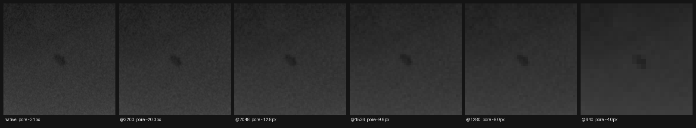

# Kiểm Chứng — Khuyết Tật Nhỏ Có Còn Tồn Tại Ở Độ Phân Giải Train?

**Ngày**: 2026-08-09 · **Loại**: verification · **Kết quả**: **giả thuyết ĐÚNG**

## Giả thuyết cần kiểm

Gas_Pore recall = 0.0 không phải vì model nhầm với Linear_Porosity, mà vì ở độ phân giải train, cái lỗ đã bị co nhỏ tới mức dưới sàn phát hiện của YOLO.

## Nguồn dữ liệu

| Nguồn | Đường dẫn | Nội dung |
|---|---|---|
| Nhãn full-film thật | `Quantum_RT/data/processed/yolo-stage1-v2` | 275 bbox / 33 phim W0003 thật (đã loại `syn_*`) |
| Kích thước thật (mm) | `dataset/gdxray/Welds/W0003/real-values.xls` | 204 dòng BAM, mã ISO 6520 |
| Scale phim | `dataset/gdxray/Welds/W0003/W0003_readme.txt` | "pixel size is 40,3 micron (630 dpi)" |
| Cấu hình train | `Quantum_RT/src/classical/train-yolo11-stage1.py:24` | `imgsz: 640`, yolo11n, phim nguyên |

Script: `plans/reports/assets/verify-small-object-visibility.py`

---

## Phát hiện 1 — Sai scale trong cả hai spec

Cả `SPEC-pipeline-upgrade-for-QuantumRT.md` §7.2 và `pipeline-fix-spec-nonvqc.md` §1 đều ghi **0,0334 mm/px**. Readme BAM ghi **40,3 micron = 0,0403 mm/px** (630 dpi).

Kiểm chứng độc lập bằng chiều dài phim:

| Giả định | Phim median 4986 px ⇒ dài |
|---|---|
| 0,0403 mm/px (BAM) | **20,1 cm** |
| 0,0334 mm/px (spec) | 16,7 cm |

`real-values.xls` chia phim thành các ô rộng 1 cm, ô lớn nhất = **20**. Phim RRT dài ~20 cm. **0,0403 mm/px khớp**; con số trong spec sai ~21%, làm mọi quy đổi mm→px bị co lại.

## Phát hiện 2 — Dải kích thước lỗ khí trong spec quá hẹp

Bảng BAM, mã 2011 (lỗ khí đơn), n = 90:

| | min | p25 | median | p75 | max |
|---|---|---|---|---|---|
| mm | 0,20 | 0,60 | **0,86** | 1,32 | 6,00 |
| px @0,0403 | 5 | 15 | **21** | 33 | 149 |

Spec ràng buộc 0,5–1,2 mm — chỉ phủ khoảng tứ phân vị giữa. Thực tế trải 0,2–6,0 mm. Sinh theo spec sẽ mất cả hai đuôi, trong đó đuôi nhỏ (0,2 mm = 5 px) chính là phần khó nhất.

## Phát hiện 3 — Kích thước đo được từ 275 bbox thật

Cạnh nhỏ nhất của bbox, ở độ phân giải phim gốc:

| Lớp | n | median | p10 |
|---|---|---|---|
| Metallic_Inclusions | 16 | 28,0 | 21,0 |
| **Gas_Pore** | 53 | **31,0** | 17,2 |
| Slag_Inclusions | 40 | 33,0 | 23,9 |
| Lack_of_Penetration | 30 | 33,0 | 19,6 |
| Continuous_undercut | 4 | 42,0 | 30,4 |
| Lack_of_Side_Wall_Fusion | 16 | 48,0 | 46,0 |
| Linear_Porosity | 19 | 49,0 | 36,2 |
| Lack_of_Root_Fusion | 16 | 51,0 | 8,5 |
| Crack | 60 | 51,5 | 31,9 |
| Elongate_Cavity | 15 | 60,0 | 29,2 |
| Clustered_localized_Porosity | 6 | 78,0 | 61,0 |

---

## Kết quả chính — tỉ lệ bbox nằm DƯỚI sàn phát hiện (8 px, tầng P3 stride 8)

| Lớp | **640** ← đang dùng | 1280 | 1536 | 2048 | 3200 |
|---|---|---|---|---|---|
| Metallic_Inclusions | **100%** | 75% | 31% | 0% | 0% |
| Lack_of_Penetration | **100%** | 43% | 33% | 10% | 0% |
| Slag_Inclusions | **98%** | 45% | 20% | 0% | 0% |
| **Gas_Pore** | **92%** | 57% | 36% | 15% | 2% |
| Linear_Porosity | 89% | 5% | 5% | 0% | 0% |
| Lack_of_Side_Wall_Fusion | 88% | 0% | 0% | 0% | 0% |
| Continuous_undercut | 75% | 0% | 0% | 0% | 0% |
| Lack_of_Root_Fusion | 75% | 38% | 38% | 38% | 25% |
| Crack | 67% | 10% | 7% | 0% | 0% |
| Elongate_Cavity | 53% | 13% | 7% | 0% | 0% |
| Clustered_localized_Porosity | 17% | 0% | 0% | 0% | 0% |

Cạnh nhỏ nhất (median) của Gas_Pore sau khi co: **4,0 px @640** · 8,0 px @1280 · 9,5 px @1536 · 12,7 px @2048 · 19,9 px @3200.

## Kiểm bằng mắt

Phim `W0003_0007`, lỗ khí tại (4028, 486), 31 px ở phim gốc — đúng mức median. Từ trái sang: native → 3200 → 2048 → 1536 → 1280 → 640. Ở ô cuối (640) lỗ chỉ còn một vệt mờ 4 px, không còn hình dạng.

---

## Kết luận

**Giả thuyết đúng.** QuantumRT stage1 train YOLO11n ở `imgsz=640` trên phim nguyên rộng ~4986 px — hệ số co 0,128×. Ở độ phân giải đó:

- **92% bbox Gas_Pore nằm dưới sàn phát hiện.** Recall 0.0 được giải thích bằng độ phân giải, không cần viện tới "khó phân biệt với Linear_Porosity".
- Ba lớp còn tệ hơn: Metallic_Inclusions và Lack_of_Penetration **100%**, Slag_Inclusions 98%.
- Không lớp nào an toàn ở 640; lớp tốt nhất (Clustered_localized_Porosity) vẫn mất 17%.

**Hệ quả cho dự án sinh ảnh**: chừng nào còn train ở 640 trên phim nguyên, ảnh synthetic dù chân thực tới đâu cũng không cứu được các lớp nhỏ — khuyết tật sinh ra rồi bị co mất trước khi model nhìn thấy. Mọi công sức ở Phase 02/03 (blend + vật lý RT) sẽ không đo được hiệu quả trên các lớp này.

**Ngưỡng đề xuất**: 2048 đưa Gas_Pore về 15% dưới sàn và 3 lớp kia về 0–10%. 3200 gần như xoá sạch vấn đề (trừ Lack_of_Root_Fusion). Đánh đổi là VRAM và thời gian train.

## Lưu ý về Lack_of_Root_Fusion

Lớp này giữ 38% dưới sàn ngay cả ở 2048 và 25% ở 3200, do p10 chỉ 8,5 px trong khi median 51 px. Đây là các bbox rất mảnh — cần xem lại vài nhãn xem là khuyết tật thật mảnh hay nhãn khoanh sai.

---

## Việc cần làm tiếp

1. Sửa `0.0334 → 0.0403 mm/px` trong cả hai spec, quy đổi lại toàn bộ ràng buộc kích thước.
2. Nới dải Gas_Pore trong spec từ 0,5–1,2 mm sang dải thật 0,2–6,0 mm (hoặc nêu rõ lý do cắt đuôi).
3. Chốt độ phân giải train trước khi sinh hàng loạt.

## Câu hỏi chưa giải quyết

1. Tăng `imgsz` lên 2048/3200 có khả thi về VRAM/thời gian trên 3090 không, hay phải quay lại cửa sổ trượt lúc suy luận?
2. `train-yolo11-stage1.py:15` trỏ vào `data/processed/yolo-w0003`, không phải `yolo-stage1-v2` mà tôi đo. Hai tập này khác nhau ở đâu?
3. Nhãn Lack_of_Root_Fusion mảnh bất thường — sai nhãn hay khuyết tật thật mảnh?
4. Bảng BAM cho kích thước theo ô 1 cm, chưa có toạ độ pixel — có cần dựng ánh xạ ô→pixel để hiệu chỉnh vị trí gieo khuyết tật không?
